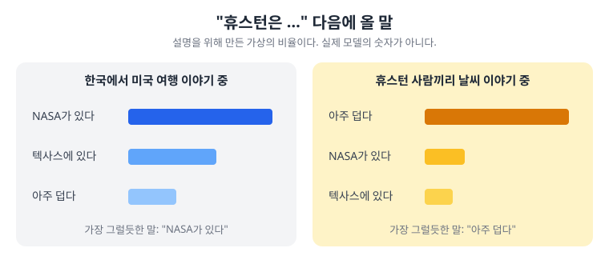

# 1. LLM은 어떻게 글을 만드나 — 그럴듯함과 정확함

> [목차](index.md) · 다음: [2. AI는 어떻게 덜 틀리게 되었나](02-LLM발전.md)

## 이 시간의 목표

ChatGPT 같은 AI가 글을 만드는 방식을 한 문장으로 설명하고, 그 방식 때문에 일에서 어떤 실수가 생기는지 네 가지로 말할 수 있다.

## 핵심 한 줄

**유창함과 정확함은 다르다. 그래서 AI의 답은 믿지 않고 확인한다.**

## 규칙을 사람이 쓰는 프로그램, 데이터로 배우는 프로그램

AI를 이해하려면 먼저 보통 프로그램과 무엇이 다른지 본다. 차이는 **규칙을 누가 만들었나**다.

에어컨 온도 조절기를 생각한다. "실내가 27도를 넘으면 켠다"는 규칙은 사람이 정했다. 이상하게 동작하면 그 규칙을 찾아 고친다. 왜 켜졌는지도 설명하기 쉽다.

이번에는 키를 보고 몸무게를 짐작하는 프로그램을 생각한다. 사람이 "키가 170cm면 몇 kg"이라는 규칙을 일일이 쓰지 않는다. 수많은 사람의 키와 몸무게를 보여 주고, 짐작이 틀린 만큼 프로그램 안의 숫자를 조금씩 고치게 한다. 이렇게 데이터로 숫자를 맞춰 가는 것을 **학습**이라고 부른다.

| | 규칙 기반 | 학습 기반 |
| --- | --- | --- |
| 규칙을 누가 만드나 | 사람이 정한다 | 데이터를 보고 숫자를 맞춘다 |
| 틀리면 | 그 규칙을 찾아 고친다 | 데이터와 학습을 다시 본다 |
| 왜 그렇게 동작했나 | 설명하기 쉽다 | 설명하기 어렵다 |
| 물려받는 것 | 사람의 실수 | 데이터의 한계와 치우침 |

오늘 다루는 AI는 모두 학습 기반이다.

## 파라미터는 지식 목록이 아니다

학습하면서 조금씩 고쳐지는 프로그램 안의 숫자를 **파라미터**라고 부른다. 공개된 예로 2020년에 나온 GPT-3는 약 1,750억 개였다. 요즘 모델의 개수는 대부분 회사가 밝히지 않는다.

나는 파라미터를 음향 믹서의 손잡이에 빗댄다. 손잡이 수천억 개를 조금씩 돌려서 원하는 소리에 가까워지게 한 것이다.

이 비유에는 한계가 있다. 믹서의 손잡이에는 "저음", "음량" 같은 이름이 붙어 있다. 파라미터에는 그런 이름이 없다. 숫자 하나가 "휴스턴은 텍사스에 있다" 같은 사실 하나를 뜻하지도 않는다. 수많은 숫자가 함께 어울려 결과를 만든다.

그래서 기억할 것은 하나다. **AI 안에는 사실을 적어 둔 목록이 없다.** 사실을 찾아서 읽어 주는 것이 아니라, 숫자의 조합으로 글을 만들어 낸다.

## LLM은 다음 낱말을 고른다

**LLM(대규모 언어 모델, Large Language Model)**은 아주 많은 글로 학습해서, 앞의 글을 보고 **다음에 올 낱말**을 고르도록 만든 AI다. ChatGPT, Claude, Gemini, Grok 안에서 글을 만드는 것이 LLM이다.

LLM은 다음에 올 후보마다 그럴듯한 정도를 매기고, 그중 하나를 골라 이어 붙인다. 이것을 한 낱말씩 되풀이해서 문장을 만든다.

후보의 순위는 두 가지로 정해진다. 학습한 글에서 무엇이 자주 이어졌는지, 그리고 지금 대화의 앞부분이 무엇인지다.

같은 "휴스턴은…"이라도 앞에서 무슨 이야기를 했느냐에 따라 가장 그럴듯한 다음 말이 달라진다. 그림의 비율은 설명을 위해 지어낸 것이다. 실제 모델 안의 숫자를 사람이 이렇게 들여다볼 수는 없다.

## 유창함과 정확함은 다르다

LLM이 고르는 기준은 **그럴듯함**이다. 그 말이 **사실인지**는 기준에 들어 있지 않다.

- 문장이 매끄럽다고 해서 내용이 맞다는 증거는 아니다.
- 번역이 자연스럽다고 해서 사실을 확인했다는 뜻은 아니다.

AI가 사람처럼 "이해했는지"는 여기서 따지지 않는다. 일하는 사람에게는 이렇게 보는 편이 안전하다. **AI는 학습한 글과 지금의 대화를 바탕으로 다음 말을 짐작했다.** 짐작은 대부분 맞지만, 맞는지는 따로 확인해야 한다.

## 같은 질문, 다른 답

계산기에 `17 × 24`를 넣으면 언제나 408이 나온다. 같은 입력이면 같은 결과가 나온다는 약속이 있다.

LLM에는 이런 약속이 없다. 같은 질문을 두 번 해도 답이 달라질 수 있다. 다음 낱말을 고를 때 가장 그럴듯한 것 하나만 고르지 않고, 그럴듯한 후보 사이에서 고르도록 만들어 두는 경우가 많기 때문이다. 설정으로 흔들림을 줄일 수는 있지만, 계산기 같은 약속이 되지는 않는다.

| | 계산기 | LLM |
| --- | --- | --- |
| 같은 입력 | 같은 결과 | 다른 결과가 나올 수 있다 |
| 맞는지는 | 계산기가 보장한다 | 내가 따로 확인한다 |

## 일에서는 네 가지로 어긋난다

이 차이가 일에서는 네 가지 실수로 나타난다. 아래는 설명을 위해 만든 예다.

| 어긋남 | 무슨 일인가 | 사무 업무의 예 |
| --- | --- | --- |
| **지어내기** (할루시네이션) | 없는 것을 있는 것처럼 쓴다 | 없는 법 조항, 없는 통계, 열리지 않는 출처 링크 |
| **더하기** | 부탁하지 않은 것을 넣는다 | 회의록 정리를 부탁했는데 메모에 없는 "다음 회의 일정"이 들어간다 |
| **빠뜨리기** | 필요한 조건을 뺀다 | "금요일까지, 공휴일 제외"에서 "공휴일 제외"가 사라진다 |
| **바꾸기** | 뜻을 바꾼다 | "검토하기로 했다"가 "확정했다"로 바뀐다 |

**할루시네이션(hallucination, 환각)**은 AI가 사실이 아닌 내용을 그럴듯하게 쓰는 현상을 부르는 말이다. 네 가지 중 가장 유명하지만, 나머지 셋도 그만큼 자주 만난다.

이 네 가지를 겁주려고 꺼낸 것은 아니다. 오늘 남은 시간은 이 넷을 줄이는 방법이다.

| 어긋남 | 줄이는 방법 | 어디서 보나 |
| --- | --- | --- |
| 지어내기 | 찾아보게 하고, 자료를 주고, 모르면 묻게 한다 | [2](02-LLM발전.md), [5](05-프롬프트.md) |
| 더하기, 빠뜨리기 | 요청에 지킬 것과 하지 말 것을 적는다 | [5](05-프롬프트.md) |
| 바꾸기 | 원문과 대조한다 | [5](05-프롬프트.md), [7](07-보안-2.md) |
| 모두 | 결과를 그대로 믿지 않는다 | [7](07-보안-2.md) |

## 그래서 믿지 말고 확인한다

결과가 흔들리는 도구는 믿음으로 다루지 않는다. 나는 이 순서로 다룬다.

1. **시킨다.** 무엇을 원하는지 분명히 말한다.
2. **본다.** 나온 결과를 읽는다.
3. **확인한다.** 원문, 출처, 계산기로 맞는지 본다.

설정과 요청을 잘 쓰면 흔들림을 줄일 수 있다. 그래도 믿을 근거는 문장의 매끄러움이 아니라 **바깥에서 한 확인**에서 얻는다.

다음 시간에는 AI 회사들이 이 약점을 어떻게 메워 왔는지 본다. 그 방법들도 결국 "바깥에서 확인하게 만들기"다.

> ✍️ **[채우기]** 내가 실제로 겪은 네 가지 어긋남 중 하나. 무엇을 맡겼고, 결과의 어디가 어긋났고, 어떻게 알아챘는지 말한다.

## 실습: 같은 질문 두 번 (5분)

1. 새 대화를 열고 내 업무와 관련된 질문 하나를 한다. 예: "휴스턴에서 작은 가게를 열 때 필요한 허가를 알려 줘."
2. 새 대화를 하나 더 열고 같은 질문을 똑같이 넣는다.
3. 두 답을 나란히 놓고 표를 채운다.

| 확인할 것 | 내 답 |
| --- | --- |
| 두 답에서 다른 곳 | |
| 내가 확인하지 않고는 믿기 어려운 내용 | |
| 그 내용을 확인할 곳(공식 사이트, 원문 등) | |

## 정리

- 보통 프로그램은 사람이 규칙을 쓴다. AI는 데이터로 파라미터를 맞춘다.
- 파라미터는 지식 목록이 아니다. AI 안에는 사실을 적어 둔 목록이 없다.
- LLM은 앞의 글과 학습한 글을 바탕으로 다음 낱말을 고른다. 기준은 그럴듯함이다.
- 같은 질문에도 답이 달라질 수 있다.
- 일에서는 지어내기, 더하기, 빠뜨리기, 바꾸기로 어긋난다.
- 믿을 근거는 바깥에서 한 확인이다.

## 참고

- [AI Literacy 발표 자료](참고/00-4.AI-Literacy.pptx) (이 편의 원래 슬라이드. 개발자용이라 예시를 바꿔 썼다)
