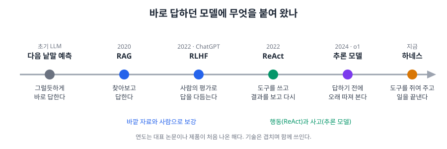

# 2. AI는 어떻게 덜 틀리게 되었나

> [목차](index.md) · 이전: [1. LLM은 어떻게 글을 만드나](01-LLM구조.md) · 다음: [3. AI 도구 용어 한눈에](03-도구용어.md)

## 이 시간의 목표

RAG, RLHF, ReAct, 추론 모델이라는 이름을 듣고, 각각이 LLM의 어떤 약점을 메우려고 나왔는지 한 문장으로 말할 수 있다.

## 핵심 한 줄

**AI의 발전은 바로 답하던 모델에 '찾아보기', '사람의 평가', '도구', '생각할 시간'을 붙여 온 과정이다.**

## 빠른 생각, 느린 생각

심리학자 대니얼 카너먼은 책 『생각에 관한 생각(Thinking, Fast and Slow)』에서 사람의 생각을 둘로 나눴다.

- **시스템 1**: 빠르고 직관적인 생각이다. "2 + 2는?"에 바로 "4"라고 답한다. 익숙한 모양을 보고 곧바로 반응한다.
- **시스템 2**: 느리지만 따져 보는 생각이다. "17 × 24는?"처럼 차근차근 계산하고 검산해야 할 때 움직인다.

여기서부터는 내 해석이다. 나는 초기 LLM을 시스템 1만 가진 기계로 본다. 그리고 지금까지의 발전을 여기에 시스템 2와 손발을 붙여 온 과정으로 본다. 사람의 뇌와 AI가 같은 방식으로 움직인다는 뜻은 아니다. 흐름을 기억하기 쉽게 하는 비유다.

## 출발점: 그럴듯하게 지어낸다

[1](01-LLM구조.md)에서 본 대로 LLM은 다음에 올 그럴듯한 낱말을 고른다. 그래서 생긴 대표 문제가 **할루시네이션**, 사실이 아닌 내용을 그럴듯하게 쓰는 현상이다. 2022년 말 처음 공개된 ChatGPT까지 이 문제는 아주 흔했다.

예를 들어 "파리의 수도는?"이라고 묻는다. 파리는 나라가 아니라 도시라서 질문 자체가 잘못되었다. 맞는 답은 "파리는 프랑스의 수도이고, 도시라서 수도가 따로 없다"다. 그런데 초기 모델은 '파리', '수도' 근처에 자주 나오던 "프랑스"를 그대로 내놓곤 했다. 질문이 이상한지 따지지 않고 가장 그럴듯한 낱말을 고른 것이다.

원인은 세 가지로 정리할 수 있다.

1. **고르는 방식**: 그럴듯함과 사실을 구분하지 않는다.
2. **학습한 글의 한계**: 배운 적 없는 내용, 오래된 내용, 틀린 내용을 그대로 물려받는다.
3. **확인 단계가 없다**: 답을 내기 전에 "이게 맞나?"를 보는 단계가 없었다.

## 세 가지 보강

### RAG: 찾아보고 답한다

**RAG(검색 증강 생성, Retrieval-Augmented Generation)**는 답하기 전에 관련 자료를 먼저 찾아서, 그 자료를 근거로 답하게 하는 방식이다.

- 기억에 기대는 시험을 **오픈북 시험**으로 바꾼 것이다.
- 학습한 뒤에 생긴 최신 정보나 회사 내부 문서도 답에 쓸 수 있다.
- 원인 2와 3을 줄인다.

### RLHF: 사람의 평가로 다듬는다

**RLHF(인간 피드백 기반 강화학습, Reinforcement Learning from Human Feedback)**는 사람이 여러 답을 보고 "이 답이 더 낫다"고 매긴 평가로 모델을 다시 학습시키는 방법이다.

- 선생님의 첨삭을 받으며 글쓰기를 배우는 것과 비슷하다.
- 답이 더 공손하고 쓸모 있어졌고, 모를 때 "잘 모르겠다"고 답하는 경향도 생겼다.
- RLHF는 할루시네이션만을 위한 기술이 아니다. 모델을 사람이 원하는 방향에 맞추는 기술이고, 할루시네이션이 줄어든 것은 그 효과 중 하나다.

### ReAct: 도구를 쓰고, 결과를 보고, 다시 따진다

**ReAct**는 Reason(추론)과 Act(행동)를 합친 이름이다. 2022년에 발표되었다. 순서는 이렇다.

1. **따진다**: "이 질문에 답하려면 오늘 환율을 알아야 한다."
2. **행동한다**: 검색 도구를 불러 환율을 찾는다.
3. **본다**: 검색 결과를 읽는다.
4. **다시 따진다**: "이제 계산할 수 있다." 필요하면 2~3을 되풀이한다.
5. **답한다.**

ReAct는 처음에 모델 안의 기능이 아니라 **요청을 쓰는 방식**으로 나왔다. 모델에게 "따지기와 행동을 번갈아 하라"고 지시하는 틀이었다. 지금은 모델이 도구 쓰는 법을 학습 단계에서 배우고, 앱이 도구를 붙여 준다. 이렇게 목표를 받아 단계를 나누고 도구를 써서 일을 끝내는 AI 도구를 흔히 **에이전트(Agent)**라고 부른다. 이 강의에서 이 말을 어떻게 좁혀 쓰는지는 [3](03-도구용어.md)에서 본다.

## 추론 모델: 답하기 전에 오래 따진다

**추론 모델(Reasoning Model)**은 답을 바로 내지 않고, 안에서 긴 생각 과정을 거친 뒤 답하도록 학습시킨 모델이다. 2024년 OpenAI의 o1이 대표적인 시작점이다. 앱에서는 이 과정이 "생각 중(Thinking)" 같은 표시로 보이기도 한다.

추론 모델은 ReAct를 늘린 것이 아니다. 출발점과 방향이 다르다.

| | ReAct | 추론 모델 |
| --- | --- | --- |
| 중심 | 행동 | 사고 |
| 방법 | 바깥 도구(검색, 계산기 등)를 쓴다 | 도구 없이 안에서 생각 과정을 길게 늘린다 |
| 처음 나온 방식 | 요청을 쓰는 틀 | 모델 자체를 그렇게 학습 |
| 비유 | 모르면 찾아보고 확인하는 사람 | 머릿속으로 차근차근 푸는 사람 |

둘 다 **한 번에 답을 내지 않고 여러 단계를 거친다.** 초기 LLM과 가장 크게 다른 점이다. 요즘 모델은 깊이 생각하는 도중에 도구도 함께 쓴다. 두 방식이 합쳐지고 있다. 다만 처음 이해할 때는 "행동과 사고"로 나눠 보는 것이 쉽다.

## 비유로 다시 본다

여기서부터는 내 해석이다. 앞의 카너먼 비유를 다시 쓰면 이렇다.

| | 시스템 1 | 시스템 2 |
| --- | --- | --- |
| 사람 | 빠르고 직관적으로 알아본다 | 느리지만 따지고 검산한다 |
| AI | 초기 LLM: 다음 낱말을 바로 고른다 | 추론 모델: 답하기 전에 단계별로 따진다 |
| 장점 | 빠르고 자연스럽다 | 복잡한 문제에 강하다 |
| 약점 | 착각이 잦다 (할루시네이션) | 느리고 비용이 많이 든다 |

"파리의 수도는?"에 바로 "프랑스"라고 답한 것은 시스템 1의 실수다. 따지는 단계가 있으면 "파리는 나라가 아니라 도시인데?"라고 질문부터 점검할 수 있다.

## 한 장으로 보는 흐름

- RAG와 RLHF는 **바깥의 자료와 사람**으로 모델을 보강했다.
- ReAct와 추론 모델은 AI 발전의 두 줄기다. 하나는 **행동**, 하나는 **사고**다.
- 마지막의 **하네스**는 모델에게 도구를 쥐여 주고 실제로 일하게 만드는 틀이다. 모델이 엔진이라면 하네스는 엔진을 실은 차다.

하네스와 도구가 무엇이고, 지금 나와 있는 AI 도구들이 어디에 속하는지는 다음 시간 [3. AI 도구 용어 한눈에](03-도구용어.md)에서 본다. 그 뒤 [4](04-모델등급.md)에서 엔진, 즉 모델을 고르는 법을 본다.

## 정리

| 단계 | 핵심 문장 |
| --- | --- |
| 원리 | LLM은 다음 낱말을 그럴듯함으로 고른다 |
| 문제 | 그래서 할루시네이션이 생긴다 |
| 보강 | RAG(찾아보기), RLHF(사람의 평가), ReAct(도구를 쓰고 다시 따지기) |
| 사고 | 추론 모델은 답하기 전에 오래 따진다. 시스템 2에 빗댈 수 있다 |
| 하네스 | 모델은 엔진, 하네스는 차. 도구를 쥐여 주는 쪽이 하네스다 |

## 참고

- [Retrieval-Augmented Generation for Knowledge-Intensive NLP Tasks](https://arxiv.org/abs/2005.11401) (RAG 논문, 2020, 영문)
- [Training language models to follow instructions with human feedback](https://arxiv.org/abs/2203.02155) (OpenAI InstructGPT 논문, RLHF, 2022, 영문)
- [ReAct: Synergizing Reasoning and Acting in Language Models](https://arxiv.org/abs/2210.03629) (ReAct 논문, 2022, 영문)
- [Learning to reason with LLMs](https://openai.com/index/learning-to-reason-with-llms/) (OpenAI o1 소개, 2024, 영문)
- 대니얼 카너먼, 『생각에 관한 생각』
