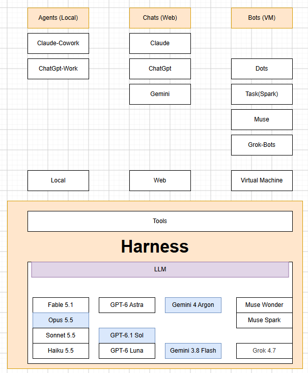

# 1. AI 도구 용어 한눈에

> [목차](index.md) · 다음: [2. 회사별 최신 모델](02-최신모델.md)

## 이 시간의 목표

뉴스와 광고에 나오는 AI 도구 이름을 듣고, 그 도구가 어디서 일하고 무엇에 닿는지, 내가 지금 쓸 수 있는지 말할 수 있다.

## 핵심 한 줄

**모델은 글만 만든다. 하네스가 도구를 쥐여 준다. 하네스가 어디서 도느냐로 도구를 세 갈래로 나눈다.**

## 먼저 세 단어

### 모델

- 앱 안에서 실제로 글을 만드는 AI다. 앞의 글을 보고 다음 낱말을 이어 쓰는 프로그램이다.
- 모델 혼자서는 글만 만든다. 파일을 열거나, 인터넷을 검색하거나, 메일을 보내지 못한다.
- 회사마다 모델이 여러 개 있다. GPT-6 Astra, Claude Opus 5.5, Gemini 4 Argon이 모델 이름이다. 모델 하나하나는 다음 시간 [2. 회사별 최신 모델](02-최신모델.md)에서 본다.

### 하네스

- **하네스**는 모델에게 도구를 쥐여 주는 틀이다. 내 요청을 모델에 넘기고, 모델이 도구를 쓰겠다고 답하면 그 도구를 실제로 실행한 뒤 결과를 다시 모델에 넘긴다. 이 일을 일이 끝날 때까지 되풀이한다.
- **도구**는 하네스가 실행할 수 있는 기능이다. 파일 읽기·쓰기, 웹 검색, 코드 실행, 브라우저 조작, 메일 보내기 같은 것이다.
- 우리가 여는 앱은 하네스와 모델을 묶어 놓은 것이다. 같은 모델이라도 어떤 하네스에 들어 있느냐에 따라 할 수 있는 일이 달라진다.

### 실행 위치

- 하네스가 도는 컴퓨터다. 내 컴퓨터일 수도 있고, 회사의 클라우드 컴퓨터일 수도 있다.
- 실행 위치가 도구가 닿는 곳을 정한다. 내 컴퓨터에서 도는 하네스는 내가 허락한 폴더에 닿는다. 클라우드에서 도는 하네스는 내가 올린 파일이나 연결해 준 서비스에만 닿는다.

자동차로 치면 모델은 엔진, 하네스는 엔진을 실은 차, 실행 위치는 차가 다니는 길이다. 엔진만으로는 어디에도 가지 못한다.

## 이 강의에서 쓰는 말

에이전트는 원래 넓은 말이다. 목표를 받으면 여러 단계를 스스로 이어서 처리하는 AI 도구는 모두 에이전트다. 그런데 이 넓은 뜻으로 쓰면 도구들이 구분되지 않는다. 그래서 이 강의에서는 하네스가 도는 곳에 따라 이름을 좁혀 쓴다.

| 이 강의의 말 | 하네스가 도는 곳 | 예 |
| --- | --- | --- |
| **에이전트(Agents)** | 내 컴퓨터 | Claude 데스크톱 앱의 작업 기능(옛 Cowork), ChatGPT Work |
| **채팅(Chats)** | 회사 클라우드의 임시 작업 공간 | 브라우저에서 쓰는 Claude, ChatGPT, Gemini |
| **봇(Bots)** | 회사의 클라우드 컴퓨터에서 계속 | dots, Gemini Spark(작업), Muse, Grok Bot |

뉴스나 회사 소개에서는 봇도 에이전트라고 부른다. 그런 글을 읽을 때는 "어디서 도는 에이전트인가"를 먼저 본다.

아래 그림은 지금까지의 말을 한 장에 모은 것이다. 아래에서 위로 읽는다. 맨 아래가 모델, 그 위가 도구를 쥔 하네스, 그 위가 하네스가 도는 곳, 맨 위가 우리가 여는 앱이다.

## 세 갈래를 견준다

| 갈래 | 언제까지 일하나 | 무엇에 닿나 | 결과가 나오는 곳 |
| --- | --- | --- | --- |
| 에이전트 | 내가 앱을 켜 둔 동안 | 내가 허락한 폴더의 파일 | 내 폴더의 문서·표·발표자료 |
| 채팅 | 대화하는 동안 | 내가 올린 파일 | 대화창의 글, 내려받는 파일 |
| 봇 | 내가 앱을 닫아도 계속 | 연결해 준 메일·일정·문서 | 연결된 서비스 |

같은 앱이 두 칸에 걸치기도 한다. Claude를 브라우저에서 쓰면 채팅이고, 데스크톱 앱에서 내 폴더를 열어 주면 에이전트다. 그래서 앱 이름보다 하네스가 어디서 도는지를 본다.

## 회사별 지도

| 회사 | 에이전트 (내 컴퓨터) | 채팅 (웹) | 봇 (클라우드 컴퓨터) |
| --- | --- | --- | --- |
| Anthropic | Claude의 작업 기능(옛 Cowork), Claude Code | Claude | — |
| OpenAI | ChatGPT의 Work, Codex | ChatGPT의 Chat | ChatGPT dots |
| Google | — | Gemini | Gemini Spark (앱에서 "작업(Tasks)"으로 이름이 바뀌는 중) |
| Meta | — | — | Muse |
| xAI | — | Grok | Grok Bot |

"—"는 그런 도구가 없다는 뜻이 아니라 이 강의에서 다루지 않는다는 뜻이다.

## Anthropic: Claude

**Cowork**
- 원래는 대화하는 Claude와 별도로, 내 폴더의 파일을 읽고 결과 파일을 만드는 작업 도구였다. 이 강의의 말로는 에이전트다.
- 2026년 9월 16일부터 대화와 하나로 합치고 있다. 요청을 보면 Claude가 대화로 끝낼지 작업으로 처리할지 정한다.
- Pro·Max 요금제부터 바뀌고, Team·무료는 뒤따른다. 한동안은 요금표에 Cowork라는 이름이 남는다.

**Claude Code**
- 개발자용이다. 프로그램 코드를 읽고 고치는 일을 맡긴다.
- 무료 요금제에는 없다. 이 강의에서는 이름만 알아 둔다.

## OpenAI: ChatGPT

**ChatGPT**
- 이제 두 가지로 나뉜다. **Chat**은 빠른 질문과 대화용이다. **Work**는 일을 맡기는 쪽이다.

**Work**
- 2026년 7월 9일에 나왔다. 여러 단계를 거쳐 문서·스프레드시트·발표자료·보고서 같은 완성된 결과물을 만든다.
- 한 번만 실행할 수도 있고, 정해진 시간마다 반복하게 할 수도 있다.
- 데스크톱 앱에서는 허락하면 내 컴퓨터의 파일을 쓴다. 이때가 이 강의에서 말하는 에이전트다.

**Codex**
- 개발과 기술 작업 전용이다. 사무 업무의 파일 작업은 Work를 먼저 본다.

**dots**
- 2026년 9월 29일에 나왔다. 이 강의의 말로는 봇이다.
- dot 하나마다 자기 클라우드 컴퓨터가 있어서, 내 목표를 향해 24시간 일한다. ChatGPT, Slack, Teams에서 부를 수 있다.
- 지금은 Pro와 Business Premium 요금제에서 일부 국가부터 열린다. 미국은 대상 지역에 들어 있다고 알려졌다. 다만 계정마다 차례로 열리고, dot을 만드는 일은 데스크톱 앱이나 컴퓨터의 웹 브라우저에서 한다.

## Google: Gemini Spark

- 2026년 5월 Google I/O에서 발표했다. 이 강의의 말로는 봇이다.
- 노트북을 덮어도 클라우드에서 계속 일한다. Gmail, 문서, 스프레드시트와 연결된다.
- 돈을 쓰거나 메일을 보내는 일은 먼저 묻는다.
- **미국에서는 Google AI Pro 이상 요금제에서 쓸 수 있다.** 처음에는 최상위 Ultra 요금제에만 있었고, 2026년 7월부터 Pro로 넓어졌다. 무료와 AI Plus 요금제에서는 아직 쓸 수 없다.
- 쓰려면 "활동 기록 유지"를 켜 두어야 한다. 이것이 왜 중요한지는 [4-1. 보안](04-보안-1.md)에서 본다.
- 2026년 10월 현재 앱에서는 "작업(Tasks)"이라는 이름으로 바뀌고 있다. Google은 아직 시험 단계라고 밝힌다.

## Meta: Muse

- **Muse는 앱 이름이면서 모델 이름이다.**
- Muse 앱은 2026년 9월에 나온 개인 에이전트다. 대답만 하지 않고 일을 대신하며, 자기 클라우드 컴퓨터에서 브라우저를 열어 일한다. WhatsApp에서도 부를 수 있다. 이 강의의 말로는 봇이다.
- **지금은 미국에서만 쓸 수 있다.** 미국에 사는 우리는 바로 써 볼 수 있다.
- 모델 이름으로는 Muse Spark, Muse Wonder가 있다. 2에서 다시 본다.

## xAI: Grok Bot

- 2026년 8월 11일에 시험판으로 나왔다. xAI는 "일을 맡길 수 있는 AI 팀원"이라고 소개한다. 이 강의의 말로는 봇이다.
- 이름을 붙인 봇마다 자기 클라우드 컴퓨터가 있어서, 노트북을 닫아도 계속 일하고 중요한 단계는 승인을 받는다.
- X 구독의 Premium(월 $30) 이상 요금제에 포함된다.
- X(옛 트위터)에서 질문에 답하는 @grok 계정과는 다른 것이다.

## 나는 이렇게 본다

여기서부터는 내 해석이다.

- 다섯 회사 중 네 곳이 2026년에 봇을 냈다. "앱을 닫아도 일한다, 메일·문서에 연결된다, 위험한 일은 묻는다"라는 설명까지 닮았다. AI 도구가 대화 상대에서 일을 맡는 쪽으로 옮겨 가고 있다.
- 그래도 처음 쓰는 사람은 채팅부터 시작한다. 에이전트는 내 폴더를, 봇은 내 메일과 문서를 넓게 열어 줘야 일한다. 무엇을 열어 줄지 정하는 법을 먼저 배운다.
- 이름은 몇 달마다 바뀐다. 이름을 외우지 말고 하네스가 어디서 도는지만 본다.

> ✍️ **[채우기]** 내가 실제로 써 본 도구와 그 갈래. 대화하는 도구와 일을 맡기는 도구를 둘 다 써 봤다면, 같은 일을 했을 때 무엇이 달랐는지 적는다.

## 실습: 내 도구 위치 찾기 (5분)

지금 쓰는 AI 앱을 열고 표를 채운다.

| 확인할 것 | 내 답 |
| --- | --- |
| 지금 쓰는 앱과 요금제 | |
| 이 앱을 어디서 여는가 (데스크톱 앱 / 브라우저 / 휴대폰) | |
| 그래서 이 앱은 어느 갈래인가 (에이전트 / 채팅 / 봇) | |
| 내 폴더나 메일에 닿는 기능이 보이는가 | |

## 정리

- 모델은 글만 만든다. 하네스가 도구를 실행해서 일을 하게 만든다.
- 하네스가 도는 곳으로 세 갈래를 나눈다. 내 컴퓨터는 에이전트, 웹은 채팅, 클라우드 컴퓨터는 봇이다.
- 같은 앱도 어디서 여느냐에 따라 갈래가 바뀐다.
- Cowork는 Claude에 합쳐지는 중이다. Muse는 아직 미국 전용이라 우리는 쓸 수 있다.

## 참고

- [Cowork is now Claude](https://claude.com/resources/articles/cowork-is-now-claude) (Anthropic)
- [ChatGPT Work and Codex](https://help.openai.com/en/articles/20001275-chatgpt-work-and-codex) (OpenAI 도움말)
- [Introducing dots](https://openai.com/index/introducing-dots/) (OpenAI)
- [Gemini Spark is no longer restricted to Google's priciest Ultra tier](https://www.digitaltrends.com/computing/gemini-spark-is-no-longer-restricted-to-googles-priciest-ultra-tier/) (Digital Trends, 미국 Pro 요금제 확대)
- [Introducing Muse](https://about.fb.com/news/2026/09/introducing-muse-personal-ai-agent/) (Meta)
- [Grok Bot 개요](https://docs.x.ai/grok-bot/overview) (xAI)
