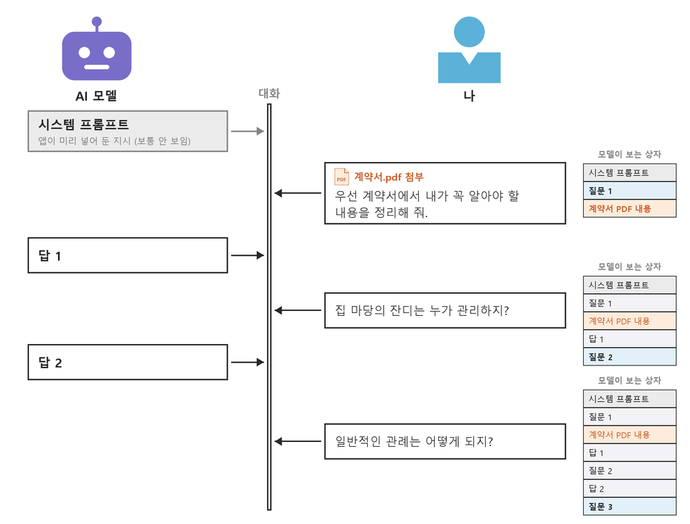

# 4-1. AI와 보안·정보 보호 — 넣기 전에, 보내기 전에

> [목차](index.md) · 이전: [3. 프롬프트 엔지니어링](03-프롬프트.md) · 다음: [4-2. 일을 맡기는 도구의 보안 — 숨은 지시](04-보안-2.md)

## 이 시간의 목표

AI에 준 정보는 털릴 수 있다고 가정하고, 털려도 문제가 작은 만큼만 AI에 맡기는 기준을 세운다. 결과를 내보내기 전에 멈출 자리를 안다.

## 핵심 한 줄

**털려도 괜찮은 만큼만 맡긴다.**

## 나의 원칙: 털린다고 가정한다

IT 보안에는 **제로 트러스트(zero trust)**라는 기본 원칙이 있다. "어떤 것도 처음부터 믿지 않는다"는 뜻이다. 그 안에 두 가지 생각이 들어 있다.

- **털렸다고 가정한다.** 막는 데만 기대지 않고, 뚫렸을 때도 피해가 작도록 미리 설계한다.
- **필요한 만큼만 준다.** 일에 꼭 필요한 권한만 주고 나머지는 닫는다.

나는 AI를 쓸 때도 이 원칙을 그대로 쓴다. **AI에 준 정보는 언젠가 털릴 수 있다고 가정한다.** 그리고 털려도 문제가 작을 만큼만 AI에 맡긴다. 그래서 판단할 질문은 하나다.

> **"이게 털리면 문제가 되나?"**

문제가 되면 주지 않는다. 내가 실제로 AI와 에이전트를 운영하는 방식은 이렇다.

| 대상 | 내가 주는 것 | 주지 않는 것 |
| --- | --- | --- |
| 은행·카드 정보 | 없다 | 계좌·카드 번호, 은행 로그인, 인증 코드 |
| 메일 | 읽기 권한 | 보내기 권한 |
| 내 컴퓨터 폴더 | 그 일에 쓸 폴더 하나만 | 그 밖의 폴더 |
| 원본 파일 | 복사본만 | 원본. 원본은 연결하지 않은 곳에 따로 보관한다 |

마지막 줄은 다른 위험을 막는다. 앞의 세 줄은 **털리는** 위험에 대한 대비다. 원본을 따로 두는 것은 **망가지는** 위험에 대한 대비다. AI가 실수로 파일을 고치거나 지워도 원본은 남는다.

- 연결한 곳의 것은 **털린다고 가정**한다. 그래서 털려도 괜찮은 것만 둔다.
- 연결한 곳의 것은 **망가진다고 가정**한다. 그래서 원본은 밖에 둔다.

이 시간의 나머지는 왜 털린다고 가정해야 하는지, 그리고 이 원칙을 매번 어떻게 지키는지다.

## 입력한 내용은 어디로 가나

대화창에 입력한 글과 올린 파일은 AI 회사의 서버로 간다. 대화 기록도 서버에 저장된다. 저장된 대화가 AI 모델을 개선하는 데 쓰이는 것을 **학습에 쓰인다**고 표현한다.

### 대화는 상자 하나에 쌓인다

나는 대화 하나를 **상자 하나**로 생각한다.

- 맨 위에는 앱이 미리 넣어 둔 지시가 있다. 이것을 **시스템 프롬프트**라고 부른다. 대화하는 사람은 보통 이 내용을 볼 수 없다.
- 내가 질문하면 질문이 상자에 들어가고, 답도 상자에 들어간다. 다음 질문과 답이 그 아래에 쌓인다.
- 파일을 첨부하면 **파일 내용도 상자에 들어간다.** 그림의 계약서 PDF는 첫 질문 때 한 번 올렸지만, 셋째 질문의 상자에도 그대로 있다.
- 모델은 답할 때마다 상자 전체를 본다. 그래서 "일반적인 관례는 어떻게 되지?"처럼 앞 대화가 있어야 뜻이 통하는 질문에도 답한다.

이 그림에서 보안에 중요한 사실이 두 가지 나온다.

1. **한 번 넣은 것은 상자에 남는다.** 대화 중간에 "아까 그 번호는 잊어 줘"라고 해도 상자에서 빠지지 않는다. 빼려면 넣기 **전에** 빼거나, 대화를 통째로 지운다.
2. **상자는 AI 회사의 서버에 있다.** 이 상자가 학습에 쓰일지, 얼마나 보관될지는 아래처럼 서비스와 설정에 따라 다르다.

학습 여부는 서비스, 요금제, 내 설정에 따라 다르다. 2026년 10월 각 회사 공식 도움말 기준이다.

| 서비스 | 개인 요금제 | 회사용 요금제 |
| --- | --- | --- |
| ChatGPT | 학습에 쓰일 수 있다. 설정에서 끌 수 있다 | Business·Enterprise는 기본으로 학습에 쓰지 않는다 |
| Claude | 가입할 때 내가 고른다. 허용하면 5년, 허용하지 않으면 30일 보관한다 | Team·Enterprise는 기본으로 학습에 쓰지 않는다 |
| Gemini | 활동 기록을 켜 두면 일부 대화를 사람이 검토하고 학습에 쓴다. 검토된 대화는 최대 3년 보관한다 | 회사·학교 계정의 대화는 허락 없이 학습에 쓰지 않는다 |

알아 둘 것 두 가지가 더 있다.

- **임시 대화**는 기록에 남지 않고 학습에도 쓰이지 않는다. 안전 점검을 위해 짧게 보관한다(ChatGPT 최대 30일, Gemini 72시간).
- **좋아요·싫어요 피드백**을 보내면, ChatGPT와 Gemini는 학습을 꺼 두었어도 그 대화가 학습에 쓰일 수 있다고 밝힌다. Claude는 피드백을 보낸 대화를 5년 보관한다. 업무 대화에는 피드백을 누르지 않는다.

여기서부터는 내 해석이다. 학습을 꺼도 나는 앞의 원칙대로 털린다고 가정한다. 학습에 쓰지 않는다는 것과 아무도 볼 수 없다는 것은 다르다. 계정이 털릴 수도 있고, 공유 링크를 잘못 보낼 수도 있고, AI가 읽은 파일 속 숨은 지시에 속을 수도 있다([4-2](04-보안-2.md)). 설정은 털리는 길 하나를 줄일 뿐이다.

## 시연: 학습 설정 끄기

강사 화면으로 세 앱의 설정을 차례로 연다. 괄호 안은 영문 화면의 이름이다. 앱을 한국어로 설정했다면 이름이 조금 다를 수 있다.

| 서비스 | 위치 | 끄면 |
| --- | --- | --- |
| ChatGPT | 설정 → 데이터 제어 → 모두를 위한 모델 개선(Improve the model for everyone) | 이후 대화가 학습에 쓰이지 않는다 |
| Claude | 설정 → 개인정보 보호 → AI 모델 개선에 도움 주기(Help improve our AI models) | 이후 대화가 학습에 쓰이지 않고 보관 기간이 30일로 줄어든다 |
| Gemini | Gemini 앱 활동(myactivity.google.com/product/gemini) → 활동 기록 유지(Keep Activity) | 72시간만 보관하고 학습에 쓰지 않는다. 대신 Gemini Spark 같은 기능을 쓸 수 없다 |

끄는 것은 **앞으로의 대화에만** 적용된다. 이미 학습에 쓰인 내용은 되돌릴 수 없다. 그래서 첫 질문을 하기 전에 설정부터 연다.

Gemini 줄을 다시 본다. 봇인 Gemini Spark는 활동 기록을 켜야 쓸 수 있다. 편리함과 자료 보호가 맞바뀌는 자리다.

## 털려도 괜찮은 만큼만 넣는다

### 이상적인 기준

가장 안전한 방법은 올리기 전에 자료를 세 가지로 나누는 것이다.

| 구분 | 예 | 하는 일 |
| --- | --- | --- |
| 그대로 넣는다 | 이미 공개된 안내문, 내가 쓴 초안, 일반적인 질문 | 그대로 쓴다 |
| 지우고 넣는다 | 고객 문의, 회의 메모, 내부 보고서 | 이름·연락처·금액을 바꾸거나 지운 뒤 넣는다 |
| 넣지 않는다 | SSN·여권 번호, 계좌·카드 번호, 비밀번호, 건강 정보, 비밀유지 약속을 한 자료, 회사가 금지한 자료 | AI 없이 처리한다 |

### 현실에서 매번 지킬 네 가지

여기서부터는 내 해석이다. 위 기준이 이상적이라는 것은 안다. 하지만 계약서 한 장을 물어볼 때마다 이름과 주소를 다 바꾸는 사람은 드물다. 대부분은 파일을 통째로 올린다. 지키지 못할 규칙은 없는 규칙과 같다.

그래서 나는 "이게 털리면 문제가 되나?"를 **매번 할 수 있는 행동 네 가지**로 바꿔 둔다.

1. **처음 한 번, 설정을 끈다.** 털리는 길 하나를 줄인다. 위 시연대로 학습 설정을 끈다. 업무 대화에는 좋아요·싫어요를 누르지 않는다.
2. **올리기 전 10초, 번호만 찾는다.** 털리면 바로 돈과 신분의 피해로 이어지는 것들이다. SSN(사회보장번호)이나 여권 번호, 카드·계좌 번호, 비밀번호가 보이면 그 페이지나 그 줄만 빼고 올린다.
   - **내** SSN이나 여권 번호는 계약서 문서에 많이 쓰이기 때문에 나는 그냥 올리는 편이다. 그러나 카드·계좌 번호와 비밀번호는 철저히 막는다. 내 정보는 털려도 내가 감당할 몫이라 여기는 수강생 여러분의 판단이다.
   - **고객의** 번호는 다르다. 3번을 따른다.
3. **남의 정보는 다르게 다룬다.** 털리면 피해가 내 선에서 끝나지 않는 것들이다. 고객 정보는 개인 계정이 아니라 회사용 요금제에서만 다룬다. 비밀유지 약속을 한 자료와 회사 규칙이 금지한 자료는 올리지 않는다. 자세한 기준은 아래 [고객의 정보는 다른 문제다](#고객의-정보는-다른-문제다)에 있다.
4. **끝나면 지운다.** 털렸을 때 꺼내 갈 양을 줄인다. 걱정되는 대화는 다 쓴 뒤 삭제한다. 처음부터 걱정되면 임시 대화로 시작한다. 삭제한다고 서버에서 바로 사라진다는 보장은 없다. 그래도 계정이 털리거나 공유 링크가 잘못 퍼졌을 때 남아 있는 것이 줄어든다.

**여유가 있으면 한 걸음 더.** 고객 명단이나 문의 모음처럼 남의 정보가 많은 자료는 지우고 넣는다.
- 이름은 역할로: "김민수 고객" → "고객 A"
- 연락처·주소는 지운다.
- 숫자는 필요한 만큼만: "$32,180" → "약 3만 2천 달러"
- 이름 없이도 사람이 드러나는 조합을 흐린다: "3층 회계팀 올해 입사자" → "한 직원"
- 결과를 받은 뒤 실제 이름과 숫자는 내가 다시 채운다.

### 고객의 정보는 다른 문제다

내 SSN은 털려도 피해를 내가 진다. 그래서 올릴지 말지는 내 판단이다. 고객의 정보는 다르다. 털리면 **고객이** 피해를 입고, 그 책임은 **가게가** 진다. 미국은 모든 주에 개인정보 유출 통지법이 있다. 고객의 이름과 SSN, 운전면허번호, 카드·계좌 번호가 함께 새면 고객에게 알려야 할 수 있다. 텍사스에서는 유출을 알게 된 날부터 60일 안에 고객에게 알려야 한다. 텍사스 주민 250명 이상의 정보가 샜다면 30일 안에 주 법무장관(Attorney General)에게도 신고해야 한다.

그래서 고객 정보를 AI로 다뤄야 한다면 나는 이렇게 권한다.

- **개인 계정이 아니라 회사용 요금제를 쓴다.** ChatGPT Business, Claude Team, 회사용 Gemini 같은 것이다. 가게를 혼자 운영해도 마찬가지다.
- **처리 위탁 계약(DPA)을 맺어 주는 서비스를 고른다.** DPA(Data Processing Agreement)는 AI 회사가 "고객 정보를 가게 일에만 쓰고, 안전하게 지키고, 사고가 나면 알리겠다"고 약속하는 계약서다. 세무사에게 장부를 맡기면서 "세금 신고에만 쓴다"는 약속을 받아 두는 것과 같다. Claude Team은 회사용 약관에 DPA가 자동으로 포함된다. ChatGPT Business는 OpenAI가 DPA를 맺을 수 있다고 안내한다. 개인 요금제에는 이런 약속이 없다.
- **회사용 요금제에서도 고객의 SSN·카드 번호는 올리지 않는다.** 회사용 요금제와 DPA는 털리는 길을 줄이고 약속을 받아 둘 뿐이다. 털린다고 가정하면 유출 통지 대상인 번호는 처음부터 빼는 것이 맞다.

텍사스에는 2024년 7월부터 시행된 개인정보법(Texas Data Privacy and Security Act, TDPSA)이 있다. 이 법은 미국 중소기업청(SBA) 기준의 소기업은 대부분 적용 대상에서 뺀다. 다만 고객의 민감한 정보를 동의 없이 파는 것은 소기업에도 금지한다.

여기서부터는 내 해석이다. 그래서 휴스턴의 소상공인 대부분에게 DPA를 맺으라고 요구하는 법은 없을 수 있다. 그래도 나는 DPA를 맺어 주는 서비스를 권한다. 고객이 "내 정보를 어디에 맡겼나"라고 물을 때 보여 줄 약속 문서가 생기기 때문이다.

업종에 따라 더 엄격한 규칙이 있다.

| 업종 | 더 볼 것 | AI에 올릴 때 |
| --- | --- | --- |
| 병원, 치과, 한의원, 약국 등 | HIPAA. 환자 정보를 맡기려면 DPA가 아니라 **BAA**라는 별도 계약이 필요하다 | ChatGPT Business와 Claude Team은 BAA를 제공하지 않는다. 환자 정보는 올리지 않는다 |
| 세무, 보험, 융자 등 | FTC Safeguards Rule. 고객 정보를 맡기는 외부 업체를 고르고, 계약으로 보안을 요구하고, 관리할 책임이 있다 | 회사용 요금제와 DPA가 기본이다. 그래도 세금·소득 자료는 신중히 다룬다 |
| 모든 업종 | 비밀유지 약속(NDA)을 한 자료, 거래처가 공유를 막은 자료 | 올리지 않는다 |

요금제 이름, DPA·BAA 제공 범위는 2026년 10월 확인한 내용이다. 바뀔 수 있으니 가입 전에 각 회사의 안내를 다시 본다. 내 업종에 무엇이 적용되는지는 회계사나 변호사에게 확인한다.

## 조심할 정보의 이름

용어를 이해하기 위한 최소한이다. 미국 기준이다. 나는 법률 전문가가 아니다. 실제 판단은 회사의 담당자나 전문가에게 묻는다.

| 용어 | 뜻 | 관련 제도 |
| --- | --- | --- |
| 개인정보(PII) | 특정인을 알아볼 수 있는 정보. 이름, 주소, 전화번호, 이메일. 다른 정보와 합쳐 알아볼 수 있어도 해당한다 | 모든 사업자에게 적용되는 연방 일반법은 없다. 텍사스는 TDPSA(소기업은 대부분 제외) |
| 유출 통지 대상 정보 | 이름과 함께 있는 SSN, 운전면허·주 ID 번호, 카드·계좌 번호. 새면 당사자에게 알려야 할 수 있다 | 50개 주의 유출 통지법. 텍사스는 60일 안에 고객에게 알린다 |
| 민감한 정보 | 건강, 인종·민족, 종교, 성적 지향, 이민·체류 신분, 범죄경력, 정확한 위치 등 | 주법마다 범위가 다르다 |
| 의료 정보(PHI) | 병원·약국 등이 다루는 환자의 진료·건강 정보 | HIPAA |
| 금융 고객 정보 | 세무·보험·융자 업체가 다루는 고객의 소득·세금·계좌 정보 | GLBA, FTC Safeguards Rule |
| 영업비밀 | 널리 알려지지 않아 경제적 가치가 있고, 비밀로 지키려고 관리한 정보 | 연방 영업비밀보호법(DTSA), 주법 |
| 저작물 | 사람이 창작한 표현물. 남의 기사, 보고서, 사진, 홍보 문구 | 미국 저작권법 |

### 예: 미국 집 리스 계약서

위 그림의 계약서를 미국에서 집을 빌리는 리스 계약서(lease)라고 하자. 위 정보가 이 계약서 어디에 있는지 찾아본다. 계약서 본문뿐 아니라 함께 받은 신청서·동의서도 본다.

| 용어 | 리스 계약서에서 찾을 수 있는 예 |
| --- | --- |
| 개인정보 | 임차인·임대인·보증인의 이름, 서명, 전화번호, 이메일, 현재 주소와 이전 주소. 이름을 지워도 "주소 + 입주일 + 반려견 이름"이 남으면 누구인지 알 수 있다 |
| 유출 통지 대상 정보 | 신청서나 신용조회 동의서에 적은 SSN과 운전면허번호, 월세 자동이체 계좌 |
| 민감한 정보 | 계약서 본문에는 드물다. 신청서에 붙은 범죄경력 조회 결과, 체류 신분 서류, 보조동물을 요청하며 낸 장애·건강 관련 서류에 들어 있을 수 있다 |
| 영업비밀 | 개인이 빌린 집이면 드물다. 회사가 직원 숙소로 빌린 계약이라면 회사가 협상한 임대료와 할인 조건이 회사가 지키는 정보일 수 있다 |
| 저작물 | 관리회사나 변호사가 만든 계약서 양식, 함께 받은 입주 안내 책자, 매물 사이트의 사진과 소개 문구 |

이 계약서로 "내가 꼭 알아야 할 내용"을 묻는다면, 앞의 [매번 지킬 네 가지](#현실에서-매번-지킬-네-가지)는 이렇게 된다.

1. 학습 설정을 끈 계정에서 연다.
2. 월세 자동이체 계좌가 적힌 페이지만 빼고 올린다. 계약 내용을 이해하는 데 필요 없다. SSN·운전면허번호가 적힌 신청서와 동의서 페이지를 뺄지는 내 판단이다. 나는 그냥 올리는 편이다. 범죄경력이나 건강 관련 서류가 붙어 있으면 그것은 뺀다.
3. 회사 숙소 계약이라 회사가 외부 공유를 막았다면 올리지 않는다.
4. 잔디 관리, 수리 책임, 해지 조건을 다 물어봤으면 대화를 지운다.

여유가 있으면 이름을 "임차인 A", "임대인 B"로 바꾸고 주소와 연락처를 지운 뒤 올린다.

이것은 **내** 계약서라서 내 판단으로 올린다. 내가 집을 빌려주는 쪽이고 세입자의 신청서를 받았다면 이야기가 다르다. 그 SSN과 신용 정보는 **고객의 정보**다. 앞의 [고객의 정보는 다른 문제다](#고객의-정보는-다른-문제다)를 따른다.

## 일을 맡기는 도구에서 더 조심할 것

[1. 도구 용어](01-도구용어.md)에서 본 에이전트와 봇은 내 폴더, 메일, 일정에 직접 접근한다. 여기서는 무엇을 넣을지보다 **어디까지 열어 줄지**가 먼저다. 열어 준 곳은 통째로 털린다고 가정한다. 앞의 [나의 원칙](#나의-원칙-털린다고-가정한다) 표가 그대로 기준이 된다.

- **폴더는 그 일에 쓸 것 하나만** 연결한다. 그 폴더에는 털려도 괜찮은 것만 둔다.
- **원본은 연결하지 않은 곳에** 따로 둔다. 연결한 폴더에는 복사본만 넣는다.
- **메일·일정은 읽기만** 허용한다. 보내기·지우기 권한은 주지 않는다.
- **밖으로 내보내는 모든 길**을 닫거나 내 승인을 받게 한다. 메일 보내기만이 아니다. 공유 링크 만들기, 웹 주소 열기, 클라우드 문서에 쓰기도 밖으로 내보내는 길이다. 결제처럼 되돌릴 수 없는 일도 같다.

메일 읽기 권한에는 함정이 하나 있다. 메일함에는 은행 알림, 인증 코드, 비밀번호 재설정 링크도 들어 있다. 메일을 읽게 하면 은행 정보를 주지 않는다는 원칙이 메일함을 통해 새어 나갈 수 있다. 그래서 나는 중요한 계정에 2단계 인증을 켜 두고, 다 쓴 인증 메일은 지운다.

왜 이렇게까지 하는지는 다음 시간 [4-2. 숨은 지시](04-보안-2.md)에서 본다. 남이 보낸 메일이나 파일에 AI를 겨냥한 문장이 숨어 있을 수 있기 때문이다. 폴더와 권한을 실제로 나누는 방법은 [5. 업무 위임 가이드](05-위임가이드.md)에서 다룬다.

## 결과에도 확인할 것이 있다

AI는 없는 사실이나 출처를 그럴듯하게 써 넣을 수 있다. 이것을 **환각**이라고 부른다. 문장이 매끄러울수록 눈에 덜 띈다.

| 자주 틀리는 자리 | 확인하는 법 |
| --- | --- |
| 날짜·요일·금액·수량 | 원문과 대조하고 계산기로 검산한다 |
| 사람 이름·담당자 | 원문에 있는 이름인지 본다 |
| 출처·법 조항·통계 | 링크를 직접 열어 그 내용이 정말 있는지 본다 |
| 약속(환불, 보상, 일정) | 내가 정한 약속인지 본다 |

AI에게 "맞는지 확인해 줘"라고 다시 묻는 것은 확인이 아니다. 어디를 볼지 고르는 데만 쓴다. 맞는지는 원문, 출처, 계산기로 판단한다.

## 내보내기 전 다섯 질문

1. **누가 받는가?** 수신자, 참조, 공개 범위
2. **되돌릴 수 있는가?** 없으면 한 번 더 읽는다.
3. **무엇을 약속하는가?** 환불, 날짜, 가격, 보상
4. **남으면 안 될 흔적이 있는가?** "고객 A" 같은 바꿔 둔 이름, "물론입니다! 아래는…" 같은 AI의 첫 줄, [확인 필요] 표시, 파일 속 메모
5. **누구의 권리인가?** 남의 글·그림체·캐릭터·로고와 비슷한가

**AI로 만들었다고 밝혀야 할까.** 내가 확인한 범위에서는 AI로 만든 글이나 그림에 일반적으로 표시를 요구하는 연방법은 없다. 대신 조심할 곳이 있다.

- **가짜 후기는 금지다.** 미국 연방거래위원회(FTC)는 2024년에 가짜 소비자 후기를 금지하는 규칙을 확정했다. AI로 만든 가짜 후기도 포함된다. 가게 후기를 AI로 지어 올리면 안 된다.
- **플랫폼 규칙과 계약을 따른다.** 광고 플랫폼, 쇼핑몰, 거래처 계약이 AI 사용 표시를 요구하면 밝힌다.
- 주마다 정치 광고나 판매용 챗봇에 따로 규칙을 둔 곳이 있다. 내 상황은 전문가에게 확인한다.

**AI 결과물의 권리.** 미국 저작권청(U.S. Copyright Office)은 2025년 1월 보고서에서 저작권은 사람의 창작에만 주어진다고 밝혔다. AI가 프롬프트만 받고 만든 결과물은 보호 대상이 아니다. 사람이 고르고 배열하거나 창작적으로 고친 부분은 보호받을 수 있다. 가게 로고처럼 오래 쓸 것은 이 점을 알고 정한다.

> ✍️ **[채우기]** 넣기 직전에 멈췄거나, 지우고 넣었거나, 보내기 직전에 고친 실제 사례 하나. 무엇을 잡았고 그 뒤로 무엇을 반드시 보게 됐는지 말한다.

## 실습: 내 계정 점검 (10분)

| 확인할 것 | 내 상태 |
| --- | --- |
| 업무용 계정인가, 개인 계정인가 | |
| 학습 설정은 켜져 있나, 꺼져 있나 | |
| 임시 대화 기능은 어디에 있나 | |
| 연결된 앱(메일·드라이브·일정)과 권한 | |
| 2단계 인증 | |
| 내 업무 자료 하나: 빼야 할 번호가 있나, 고객의 정보가 들어 있나 | |
| 고객 정보를 다룬다면: 회사용 요금제인가, DPA가 있나 | |
| 지난 대화 중 지울 것이 있나 | |

## 정리

- AI에 준 정보는 털릴 수 있다고 가정한다. 판단할 질문은 "이게 털리면 문제가 되나?" 하나다.
- 대화는 서버에 있는 상자 하나에 쌓인다. 한 번 넣은 것은 그 상자에 남는다. 학습 설정은 털리는 길 하나를 줄일 뿐이다.
- 매번 지킬 네 가지: 처음에 설정을 끄고, 올리기 전에 번호만 빼고, 남의 정보는 다르게 다루고, 끝나면 대화를 지운다.
- 내 정보는 내 판단이다. 고객의 정보는 다른 문제다. 회사용 요금제와 DPA를 맺어 주는 서비스를 쓰고, 고객의 SSN·카드 번호와 환자 정보는 올리지 않는다.
- 여유가 있으면 남의 정보가 많은 자료는 이름·연락처를 지우고 넣는다.
- 일을 맡기는 도구에는 은행 정보를 주지 않고, 메일은 읽기만, 폴더는 하나만 열고, 원본은 따로 둔다. 밖으로 내보내는 모든 길은 닫거나 내가 승인한다. 이유는 [4-2](04-보안-2.md)에서 본다.
- 결과는 초안이다. 보내기 전에 다섯 질문으로 멈춘다.

## 참고

- [ChatGPT 데이터 제어](https://help.openai.com/en/articles/7730893-data-controls-in-chatgpt) (OpenAI 도움말)
- [Claude 모델 개선 설정 변경](https://privacy.claude.com/en/articles/12109829-how-do-i-change-my-model-improvement-privacy-settings) (Anthropic)
- [Gemini 앱 개인정보 보호 허브](https://support.google.com/gemini/answer/13594961?hl=ko) (Google)
- [Anthropic Data Processing Addendum](https://www.anthropic.com/legal/data-processing-addendum) (Anthropic)
- [Enterprise privacy](https://openai.com/enterprise-privacy/) (OpenAI, Business 요금제의 데이터 정책 포함)
- [Security Breach Notification Laws](https://www.ncsl.org/technology-and-communication/security-breach-notification-laws) (NCSL, 주별 유출 통지법)
- [텍사스 SB 768 법안 분석](https://capitol.texas.gov/tlodocs/88R/analysis/html/SB00768F.htm) (텍사스 의회, 유출 신고 기한 단축)
- [Texas Passes Comprehensive Privacy Bill](https://fpf.org/blog/the-right-to-be-let-a-lone-star-state-texas-passes-comprehensive-privacy-bill/) (Future of Privacy Forum, TDPSA 해설)
- [HIPAA](https://www.hhs.gov/hipaa/index.html) (미국 보건복지부)
- [Copyright and Artificial Intelligence](https://www.copyright.gov/ai/) (미국 저작권청)
- [FTC의 가짜 후기 금지 규칙 보도](https://techcrunch.com/2024/08/14/ftc-finalizes-rule-banning-fake-reviews) (TechCrunch)
