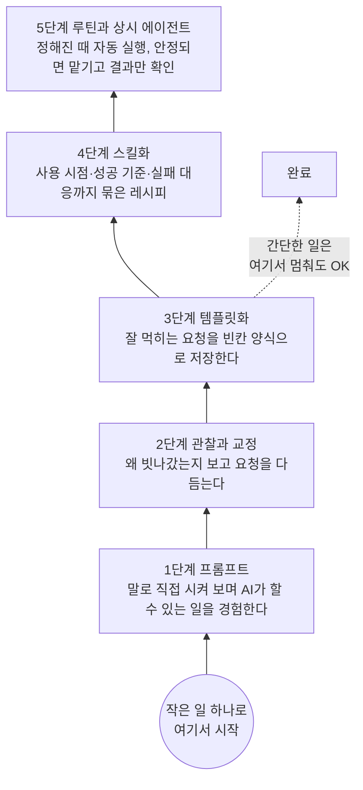
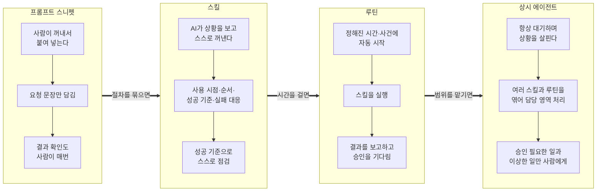
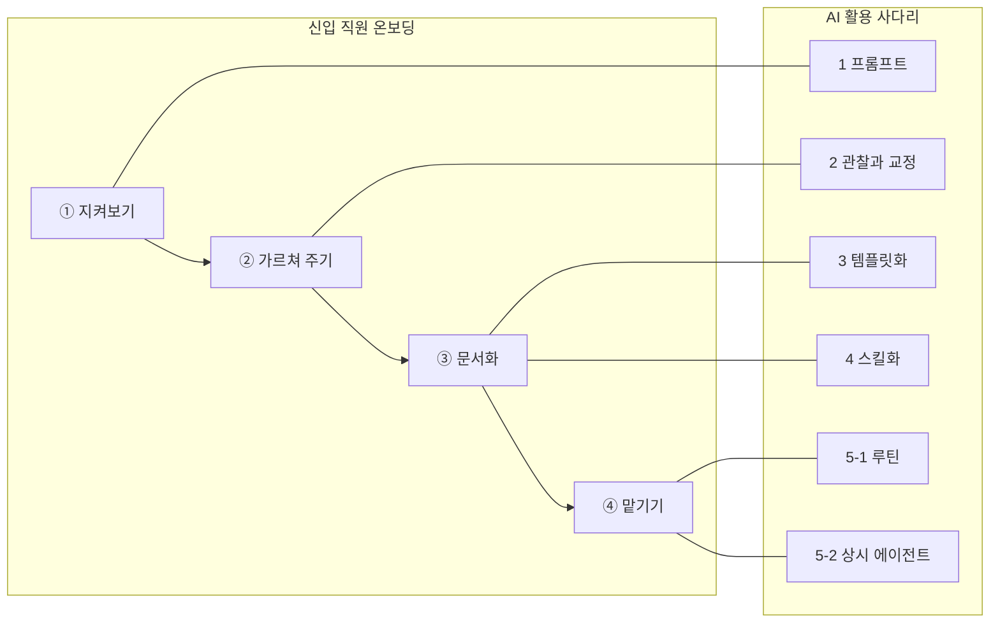

# AI 활용 사다리: 프롬프트에서 상시 에이전트까지 5단계

> **이 문서의 한 문장**
> AI는 처음부터 "알아서 다 해 주는 비서"로 쓰는 것이 아닙니다. **작은 일 하나로 시작해서 한 칸씩 올라가며** 맡기는 것입니다.

- 대상: AI 에이전트 강의를 듣는 비개발자 일반인
- 용도: 강의 자료, 수강생 배포용 읽기 자료
- 구성: 서론 → 5단계 상세 → 전환 기준 → 흔한 실수 → 온보딩 비유 표 → 다이어그램 → 자동화 안전 메모 → 한 장 요약표 → 참고 문헌
- 기준일: 2026년 10월 30일 (참고 문헌의 내용과 링크는 이 날짜에 확인했습니다)

---

## 0. 먼저 알아 둘 용어

처음 나오는 용어는 본문에서도 풀어 쓰지만, 한곳에 모아 두면 강의 중에 다시 찾아보기 편합니다.

| 용어 | 쉬운 설명 |
|---|---|
| **AI 챗봇** | 글로 묻고 글로 답을 받는 AI 프로그램. ChatGPT, Claude, Gemini, Grok 같은 서비스가 여기에 속합니다. |
| **프롬프트(prompt)** | AI에게 보내는 요청 문장. "이메일 써 줘"처럼 우리가 입력창에 쓰는 말 전체를 가리킵니다. |
| **템플릿(template)** | 빈칸이 뚫린 양식. 매번 이름·날짜·수량 같은 빈칸만 바꿔 쓰는 정형화된 프롬프트입니다. |
| **스니펫(snippet)** | 저장해 둔 텍스트 조각. 사람이 직접 꺼내서 붙여 넣어야 작동합니다. |
| **스킬(skill)** | 템플릿 + "언제 쓰는지" + "성공 기준" + "실패하면 확인할 것"을 하나로 묶은 **완성된 작업 레시피**. AI가 상황을 보고 스스로 꺼내 씁니다. |
| **루틴(routine)** | 정해진 시간이나 사건(예: "매주 일요일 저녁 6시", "메일이 오면")에 스킬이 **자동으로 실행되도록** 걸어 둔 예약 작업입니다. |
| **AI 에이전트(agent)** | 답만 하는 데서 그치지 않고, 도구(검색, 메일, 캘린더, 웹사이트 등)를 직접 써서 **일을 끝까지 처리하는** AI입니다. |
| **상시 에이전트(always-on agent)** | 내 컴퓨터가 꺼져 있어도 클라우드에서 계속 대기하면서 맡긴 일을 처리하고, 필요할 때만 사람을 부르는 에이전트입니다. |
| **승인 게이트(approval gate)** | 보내기·결제·삭제처럼 되돌리기 어려운 행동 직전에 "사람이 확인 버튼을 눌러야 다음으로 넘어가는" 관문입니다. |
| **할루시네이션(hallucination)** | AI가 사실이 아닌 내용을 그럴듯하게 지어내는 현상. "환각"이라고도 부릅니다. |
| **커넥터(connector)** | AI가 내 메일, 캘린더, 드라이브 같은 다른 서비스에 접근할 수 있게 연결해 주는 장치입니다. |

---

## 1. 서론: 왜 사다리가 필요한가

### 1-1. 사람들이 AI에서 실망하는 가장 흔한 이유

> **핵심 문장:** 실망은 대개 AI의 능력 부족이 아니라, **너무 높은 칸에서 시작한 결과**입니다.

AI 에이전트 소식을 들으면 이런 상상을 하게 됩니다. "내 메일을 알아서 정리하고, 장도 봐 주고, 일정도 잡아 주는 비서가 생기겠구나." 그래서 첫날부터 "내 일주일을 전부 관리해 줘"라고 맡깁니다. 결과는 대부분 실망스럽습니다.

이건 신입 직원에게 첫날 "회사 일 알아서 다 해 주세요"라고 하는 것과 같습니다. 아무리 똑똑한 사람이어도 우리 집 사정, 내 취향, 우리 회사의 규칙을 모르면 일을 제대로 할 수 없습니다. AI도 똑같습니다.

### 1-2. 사다리라는 생각

그래서 이 강의는 AI 쓰는 법을 **다섯 칸짜리 사다리**로 정리합니다.

1. **프롬프트**: 말로 직접 시켜 본다
2. **관찰과 교정**: 왜 빗나갔는지 보고 고쳐 말한다
3. **템플릿화**: 잘 먹히는 말을 빈칸 양식으로 저장한다
4. **스킬화**: 양식에 "언제, 무엇이 성공인지, 실패하면 무엇을 볼지"까지 묶는다
5. **루틴과 상시 에이전트**: 정해진 때에 저절로 돌게 하고, 나중에는 아예 맡긴다

### 1-3. 이 사다리의 세 가지 규칙

> **규칙 1. 아래에서 위로 올라갑니다.** 처음부터 상시 에이전트를 만들지 않습니다.
>
> **규칙 2. 한 번에 한 칸씩, 작은 일 하나로 시작합니다.** 한 가지 일로 사다리를 끝까지 올라가 본 경험이, 열 가지 일을 1단계에서 맴도는 것보다 훨씬 값집니다.
>
> **규칙 3. 모든 일이 꼭대기까지 갈 필요는 없습니다.** 일의 무게에 맞춰 멈출 칸을 고릅니다. 간단한 일은 3단계(템플릿)에서 끝내도 충분합니다.

이 방향은 AI 회사들이 내놓는 공식 안내와도 같습니다. 예를 들어 Grok Bot 공식 문서는 "일회성 작업으로 시작해 믿을 만하게 만든 뒤, 그 방법을 스킬로 저장하고, 그다음에야 자동화하라"고 안내합니다. Anthropic의 에이전트 설계 글도 "가장 단순한 방법부터 시작하고, 필요할 때만 복잡도를 올리라"고 권합니다. (자세한 출처는 10장 참고 문헌에 있습니다.)

### 1-4. 이 문서에서 계속 따라갈 예시

사다리는 **같은 일 하나를 들고 올라가 볼 때** 가장 잘 이해됩니다. 이 문서는 두 가지 예시를 끝까지 따라갑니다.

| 예시 | 내용 | 누구에게 맞나 |
|---|---|---|
| **🍲 주력 예시: 주간 가족 식단과 장보기 목록** | 4인 가족의 일주일 저녁 메뉴를 정하고, 장볼 목록을 만드는 일 | 가정, 살림, 개인 생활 |
| **📧 보조 예시: 주간 업무 보고 이메일** | 매주 금요일 팀장에게 보내는 업무 보고 메일 | 직장인 |

---

## 2. 5단계 상세 설명

각 단계는 같은 틀로 설명합니다.

- **한 줄 정의**: 이 단계가 무엇인지
- **이 단계의 목적**: 여기서 얻어 가야 할 것
- **따라 해 보기**: 실제로 입력할 수 있는 문장
- **이 단계에서 사람이 하는 일**: 내 역할

---

### 1단계. 프롬프트: 일단 말로 시켜 본다

> **한 줄 정의:** 하고 싶은 일을 말로 직접 시켜서 결과를 받는 단계입니다. 매번 새로 씁니다.
>
> **핵심 문장:** 이 단계의 목표는 "잘 쓰기"가 아니라 **"AI가 이런 것도 하는구나"를 몸으로 겪는 것**입니다.

#### 이 단계의 목적

- AI가 무엇을 잘하고 무엇을 못하는지 직접 확인합니다.
- "생각보다 쓸 만하네" 또는 "이건 내가 하는 게 낫겠다"는 첫 감을 잡습니다.
- 완벽한 문장을 쓰려고 고민하지 않습니다. 친구에게 부탁하듯 말하면 됩니다.

#### 따라 해 보기 🍲 식단

AI 챗봇 입력창에 그대로 써 보세요.

```text
이번 주 저녁 메뉴 좀 짜 줘.
```

아마 그럴듯한 7일 메뉴가 나올 겁니다. 그런데 우리 집 사정은 하나도 반영되지 않았을 거예요. 괜찮습니다. 1단계에서는 그게 정상입니다.

조금 더 말해 보면 이렇습니다.

```text
4인 가족(어른 2, 초등학생 2) 이번 주 저녁 메뉴 7일치 짜 주고,
장볼 목록도 같이 만들어 줘.
```

#### 따라 해 보기 📧 보고 메일

```text
팀장님께 보낼 주간 업무 보고 메일 써 줘.
이번 주에 한 일: 거래처 A 견적 발송, 신규 직원 교육 2회, 월말 정산 준비.
```

#### 다른 일상 예시

- 여행: "다음 달 2박 3일 부산 여행 일정 짜 줘."
- 요리: "냉장고에 계란, 두부, 대파가 있는데 20분 안에 만들 수 있는 반찬 알려 줘."

#### 이 단계에서 사람이 하는 일

- 결과를 **그대로 믿지 말고 읽어 봅니다.** 특히 가게 영업시간, 가격, 날짜 같은 사실 정보는 AI가 지어낼 수 있습니다(할루시네이션).
- "좋았던 점"과 "아쉬웠던 점"을 한 줄씩 메모해 둡니다. 이 메모가 2단계의 재료가 됩니다.

---

### 2단계. 관찰과 교정: 왜 빗나갔는지 보고 고쳐 말한다

> **한 줄 정의:** 결과가 마음에 안 들면, 왜 틀렸는지 살펴보고 요청을 다듬는 단계입니다.
>
> **핵심 문장:** AI가 틀린 이유의 대부분은 **"내가 말하지 않은 것"**입니다. 내 머릿속의 조건을 꺼내서 글로 적는 연습이 이 단계의 전부입니다.

#### 이 단계의 목적

- 결과가 빗나간 원인을 **AI 탓/내 설명 탓**으로 구분하는 눈을 기릅니다.
- 같은 요청을 몇 번 바꿔 보면서 **어떤 표현이 잘 먹히는지** 감을 잡습니다.
- "우리 집의 숨은 규칙"을 하나씩 발견합니다.

#### 따라 해 보기 🍲 식단: 1단계 결과를 관찰하기

1단계 결과를 보니 이런 문제가 있었다고 해 봅시다.

| 관찰한 문제 | 원인 | 고칠 말 |
|---|---|---|
| 월요일에 연어 스테이크가 나옴 | 예산을 말하지 않음 | "일주일 장보기 예산은 15만 원" |
| 둘째가 못 먹는 새우가 들어감 | 알레르기를 말하지 않음 | "둘째는 갑각류 알레르기" |
| 평일인데 1시간 걸리는 요리 | 조리 시간을 말하지 않음 | "평일은 30분 안에" |
| 장볼 목록에 집에 있는 쌀이 있음 | 집에 있는 재료를 말하지 않음 | "쌀, 간장, 식용유는 집에 있음" |
| 메뉴가 표 없이 길게 나열됨 | 원하는 모양을 말하지 않음 | "요일별 표로, 장볼 목록은 코너별로" |

#### 따라 해 보기 🍲 식단: 고쳐 말하기

```text
아까 메뉴 다시 짜 줘. 이번엔 아래 조건을 지켜 줘.
- 가족: 어른 2, 초등학생 2. 둘째는 갑각류(새우·게) 알레르기.
- 일주일 장보기 예산: 15만 원 이내
- 평일(월~금) 저녁은 30분 안에 만들 수 있는 것
- 집에 이미 있는 것: 쌀, 간장, 식용유, 계란
- 결과 모양: 요일별 표(요일 | 메뉴 | 조리 시간), 그 아래 장볼 목록을 마트 코너별로
```

#### 같은 질문을 여러 번 던져 보기

같은 요청을 두세 번 해 보거나, 말을 살짝 바꿔 보세요.

- "아이들이 좋아하는 메뉴로" vs "아이들이 채소를 먹을 수 있는 메뉴로" → 결과가 꽤 다릅니다.
- "장볼 목록 만들어 줘" vs "장볼 목록을 수량까지 적어서 만들어 줘" → 후자가 훨씬 쓸모 있습니다.

이렇게 **비교해 보는 것 자체가 공부**입니다. 잘 먹힌 표현에는 메모장에 별표를 쳐 두세요.

#### 따라 해 보기 📧 보고 메일

1단계 메일이 "너무 길고, 말투가 딱딱하고, 다음 주 계획이 빠졌다"고 느꼈다면:

```text
아까 메일을 다시 써 줘.
- 길이: 모바일에서 한 화면 안에 들어오게
- 말투: 정중하지만 짧게, "~했습니다" 체
- 구성: ① 이번 주 한 일 ② 이슈/도움 필요한 점 ③ 다음 주 계획
- 다음 주 계획: 거래처 A 계약 미팅, 정산 마감
```

#### 이 단계에서 사람이 하는 일

- AI의 결과를 **"선생님이 채점하듯"** 봅니다. 맞은 것, 틀린 것, 빠진 것.
- 고칠 때는 화내듯 "다시 해"가 아니라 **"무엇을 어떻게"** 바꿀지 말합니다.

---

### 3단계. 템플릿화: 잘 먹히는 말을 빈칸 양식으로 저장한다

> **한 줄 정의:** 여러 번 써 보니 비슷한 패턴이 보이면, 그걸 복사·붙여 넣기 할 수 있게 저장해 두는 단계입니다. 이름, 날짜, 수량 같은 빈칸만 바꾸면 됩니다.
>
> **핵심 문장:** 템플릿은 **2단계에서 고생해서 얻은 깨달음을 잃어버리지 않게 붙잡아 두는 그릇**입니다.

#### 이 단계의 목적

- 매번 조건을 처음부터 다시 쓰는 수고를 없앱니다.
- 결과의 품질이 들쭉날쭉하지 않고 **일정해집니다.**
- 가족이나 동료에게도 "이거 복사해서 쓰면 돼"라고 나눠 줄 수 있습니다.

#### 따라 해 보기 🍲 식단 템플릿

메모 앱, 노트 앱, 또는 AI 서비스의 "저장된 프롬프트" 기능에 아래를 저장해 둡니다. `[ ]` 부분이 매주 바꿀 빈칸입니다.

```text
[주간 저녁 식단 + 장보기 목록]

기간: [2026년 11월 2일(월) ~ 11월 8일(일)]
가족: 어른 2, 초등학생 2. 둘째는 갑각류(새우·게) 알레르기.
이번 주 예산: [15만 원]
이번 주 특이사항: [수요일은 외식, 토요일 점심에 손님 2명 추가]
집에 남아 있는 재료: [양파 3개, 두부 1모, 냉동 닭가슴살 500g]
조건:
- 평일 저녁은 30분 안에 만들 수 있는 것
- 같은 주재료가 3일 연속 나오지 않게
- 남은 재료를 먼저 쓰는 메뉴로 시작
결과 모양:
1) 요일별 표 (요일 | 메뉴 | 조리 시간 | 주재료)
2) 장볼 목록: 마트 코너별(채소/정육/수산/유제품/기타), 품목마다 수량
3) 예상 총액 (대략)
```

다음 주에는 날짜, 예산, 특이사항, 남은 재료만 바꿔서 붙여 넣으면 됩니다.

#### 따라 해 보기 📧 보고 메일 템플릿

```text
[주간 업무 보고 메일]

받는 사람: [김 팀장님]
보고 주간: [11월 2일 ~ 11월 6일]
이번 주 한 일: [목록]
이슈/도움 필요: [없으면 "없음"]
다음 주 계획: [목록]
규칙: 모바일 한 화면 분량, "~했습니다" 체, 제목은 "[주간보고] 이름 / 날짜"
```

#### 3단계에서 멈춰도 되는 일

간단하고, 가끔 하고, 틀려도 손해가 적은 일은 **여기서 끝내도 충분**합니다.

- 생일 축하 문자 양식
- 중고 거래 판매글 양식
- 회의 안내 문자 양식

#### 이 단계에서 사람이 하는 일

- 템플릿을 **어디에 저장했는지** 정해 둡니다. (찾지 못하는 템플릿은 없는 것과 같습니다.)
- 빈칸을 채워 붙여 넣는 일, 결과를 읽어 보는 일은 **여전히 사람이 합니다.**

---

### 4단계. 스킬화: 절차 전체를 하나의 레시피로 묶는다

> **한 줄 정의:** 템플릿에 더해 **언제 쓰는지, 성공 기준은 무엇인지, 실패하면 무엇을 확인할지**까지 절차 전체를 하나로 묶는 단계입니다.
>
> **핵심 문장:** 템플릿은 "무엇을 말할지"를 저장하고, 스킬은 **"이 일을 어떻게 끝내는지"**를 저장합니다. 이제 사람이 과정을 기억하지 않아도 됩니다.

#### 스니펫과 스킬은 어떻게 다른가

| | 프롬프트 스니펫(텍스트 조각) | 스킬(완성된 레시피) |
|---|---|---|
| 꺼내는 사람 | **사람**이 매번 찾아서 붙여 넣음 | **AI**가 상황을 보고 스스로 꺼냄 |
| 담긴 것 | 요청 문장 | 사용 시점 + 필요한 재료 + 순서 + 성공 기준 + 실패 대응 + 하지 말 것 |
| 실패했을 때 | 사람이 알아채고 다시 물어야 함 | 스킬 안에 "이럴 땐 이걸 확인"이 적혀 있음 |
| 비유 | 요리책에서 찢어 낸 재료 목록 한 장 | 재료, 순서, 완성 사진, "탔으면 이렇게" 팁까지 있는 레시피 카드 |

Anthropic은 스킬을 소개하며 "에이전트에게 스킬을 만들어 주는 것은 신입 직원을 위한 온보딩 안내서를 만드는 것과 비슷하다"고 설명했습니다. 이 강의의 "직원 온보딩" 비유(6장)와 정확히 같은 생각입니다.

> 참고: "스킬"이라는 이름과 저장 방식은 서비스마다 조금씩 다릅니다. Claude는 "Agent Skills", Grok Bot은 "스킬", Hermes Agent는 "skills"라고 부르고, 아직 스킬 기능이 없는 서비스라면 **잘 정리된 문서 한 장**을 대화 시작 때 함께 주는 것으로도 비슷한 효과를 낼 수 있습니다.

#### 좋은 스킬에 들어가는 6가지

1. **언제 쓰는가** (사용 시점)
2. **필요한 재료와 권한** (입력값, 접근해야 할 앱)
3. **작업 순서**
4. **성공 기준** (결과가 이러면 합격)
5. **실패하면 확인할 것**
6. **사람 승인이 필요한 일 / 절대 하지 말 것**

#### 따라 해 보기 🍲 식단 스킬

아래는 사람이 읽어도, AI가 읽어도 이해되는 스킬 예시입니다. 스킬 기능이 있는 서비스에서는 "이 내용으로 '주간 식단' 스킬을 저장해 줘"라고 말하면 됩니다.

```text
# 스킬 이름: 주간 가족 식단과 장보기 목록

## 언제 쓰나
- 사용자가 "이번 주 식단", "장보기 목록", "다음 주 메뉴"를 말할 때
- 매주 일요일 저녁 루틴에서 호출될 때

## 필요한 재료
- 가족 정보(고정): 어른 2, 초등학생 2. 둘째는 갑각류 알레르기.
- 이번 주에 물어볼 것: 예산, 외식/손님 일정, 남은 재료
  (사용자가 말하지 않으면 "지난주와 같음"으로 가정하고, 가정했다고 표시)

## 순서
1. 남은 재료를 먼저 쓰는 메뉴로 월·화를 채운다.
2. 평일은 30분 이하 메뉴만 고른다.
3. 같은 주재료 3일 연속 금지.
4. 요일별 표를 만든다.
5. 장볼 목록을 마트 코너별로, 수량과 함께 만든다.
6. 예상 총액을 계산한다.

## 성공 기준 (모두 통과해야 완료)
- [ ] 갑각류(새우, 게, 랍스터, 새우젓 포함)가 하나도 없다
- [ ] 예상 총액이 예산 이내다
- [ ] 평일 메뉴의 조리 시간이 모두 30분 이하다
- [ ] 장볼 목록의 모든 재료가 표의 메뉴와 연결된다 (안 쓰는 재료 없음)

## 실패하면 확인할 것
- 예산 초과 → 비싼 주재료(소고기, 수산물)를 돼지고기·두부·계란 메뉴로 바꿔 다시 계산
- 알레르기 재료 발견 → 그 메뉴를 빼고 대체 메뉴 제안, 사용자에게 "바꿨다"고 알림
- 가격 정보가 불확실 → "대략적인 금액"이라고 표시하고 지어내지 않기

## 하지 말 것 / 승인 필요
- 온라인 장보기 앱의 장바구니에 담는 것까지는 해도 됨
- **결제는 절대 하지 않음.** 결제 직전 화면 요약을 보여 주고 사람의 확인을 기다림
```

#### 따라 해 보기 📧 보고 메일 스킬 (요약형)

```text
# 스킬 이름: 주간 업무 보고 메일 초안

언제: 금요일 오후, 또는 사용자가 "주간 보고"를 말할 때
재료: 이번 주 캘린더 일정, 할 일 목록에서 완료된 항목
순서: 일정·할 일 수집 → 3단 구성(한 일/이슈/다음 주) → 템플릿 규칙 적용
성공 기준: 한 화면 분량, 완료 항목 누락 없음, 확인 안 된 숫자 없음
실패 시: 캘린더 접근이 안 되면 "자료 없음"이라고 알리고 추측으로 채우지 않기
승인 필요: **메일 발송은 반드시 사람이 확인 후.** AI는 초안까지만.
```

#### 이 단계에서 사람이 하는 일

- 스킬을 **처음 몇 번은 옆에서 지켜보며** 성공 기준이 실제로 지켜지는지 확인합니다.
- 실패 사례가 나오면 "실패하면 확인할 것"에 한 줄씩 추가합니다. 스킬은 **자라는 문서**입니다.

---

### 5단계. 루틴과 상시 에이전트: 정해진 때 저절로 돌게 하고, 나중엔 맡긴다

> **한 줄 정의:** 잘 작동하는 스킬을 시간에 맞춰 자동 실행되게 걸어 두고(루틴), 그게 안정적으로 돌아가면 아예 상시 에이전트에게 맡기는 단계입니다.
>
> **핵심 문장:** 5단계의 사람은 "일하는 사람"에서 **"결과를 확인하는 사람"**으로 역할이 바뀝니다. 확인을 그만두는 것이 아닙니다.

5단계는 안에서 다시 두 칸으로 나눠 생각하면 쉽습니다.

| 칸 | 무엇이 달라지나 | 사람이 하는 일 |
|---|---|---|
| **5-1. 루틴** | 내가 부르지 않아도 정해진 시간에 스킬이 실행됨 | 매번 결과를 확인하고 승인 |
| **5-2. 상시 에이전트** | 시간뿐 아니라 상황(메일 도착, 일정 변경 등)을 보고 알아서 움직이고, 여러 스킬을 엮어 씀 | 승인이 필요한 순간과 이상한 결과만 확인 |

#### 따라 해 보기 🍲 식단 루틴 (5-1)

루틴 기능이 있는 AI 서비스(예: Grok Bot의 routines, Claude Code의 scheduled tasks, Hermes Agent의 예약 작업)에 이렇게 말합니다.

```text
매주 일요일 오후 6시(한국 시간)에 '주간 가족 식단과 장보기 목록' 스킬을 실행해 줘.
- 먼저 나에게 이번 주 예산, 외식/손님 일정, 남은 재료를 물어봐.
- 내가 저녁 8시까지 답이 없으면 "지난주와 같음"으로 가정하고, 가정했다고 적어 줘.
- 결과는 이 대화에 표로 올려 줘.
- 장바구니 담기까지는 해도 되지만, 결제는 하지 말고 결제 직전 요약을 보여 줘.
- 장보기 앱에 접속이 안 되면 옛날 정보로 채우지 말고 "접속 실패"라고 알려 줘.
```

루틴을 만든 뒤에는 바로 믿지 말고 **"테스트 실행"을 한 번** 해 봅니다. 그리고 첫 2~3주는 결과를 꼼꼼히 봅니다.

#### 따라 해 보기 🍲 상시 에이전트로 넘기기 (5-2)

루틴이 몇 주 동안 문제없이 돌았다면, 이제 범위를 조금 넓혀 상시 에이전트에게 "살림 담당"을 맡겨 볼 수 있습니다.

```text
앞으로 우리 집 식단과 장보기를 담당해 줘.
- 기본은 매주 일요일 식단 루틴.
- 가족 캘린더에 외식이나 손님 일정이 새로 생기면 그 주 식단을 알아서 조정해서 알려 줘.
- 장바구니 총액이 예산을 넘으면 바로 알려 줘.
- 결제, 주문 확정, 다른 사람에게 메시지 보내기는 항상 내 확인을 받아.
- 매달 첫째 주에 "지난달 식비 요약"을 보여 줘.
```

#### 따라 해 보기 📧 보고 메일 루틴

```text
매주 금요일 오후 4시에 '주간 업무 보고 메일 초안' 스킬을 실행해서
초안을 내 메일함의 임시 보관함에 저장하고 나에게 알려 줘. 발송은 내가 직접 할게.
```

#### 이 단계에서 사람이 하는 일

- **결과 확인**: 매번(루틴 초기) → 가끔(안정기) → 알림 올 때(상시 에이전트)
- **승인**: 보내기, 결제, 삭제, 공개 게시는 계속 사람이 누릅니다. (8장 안전 메모 참고)
- **정기 점검**: 한 달에 한 번, "이 루틴이 아직 필요한가? 아직 맞게 돌고 있나?"를 봅니다. 쓰지 않는 루틴은 멈춥니다. 루틴은 실행될 때마다 사용량(요금)을 쓰기 때문입니다.

---

## 3. 단계 간 전환 기준: 언제 다음 칸으로 올라가나

> **핵심 문장:** 다음 칸으로 올라가는 신호는 **"반복"과 "안정"**입니다. 같은 일을 자주 하게 되고, 결과가 믿을 만해졌을 때 올라갑니다.

### 3-1. 전환 체크리스트

| 전환 | 올라가도 되는 신호 (2개 이상이면 올라가 보세요) | 아직 이른 신호 |
|---|---|---|
| **1 → 2** (프롬프트 → 관찰과 교정) | • 결과가 "쓸 만한데 아쉽다"<br>• 같은 일을 또 시킬 것 같다<br>• 아쉬운 점을 말로 설명할 수 있다 | • 이 일은 다시 할 일이 없다<br>• 결과가 이미 충분히 좋다 → 여기서 끝 |
| **2 → 3** (교정 → 템플릿) | • 같은 조건을 **세 번 이상** 다시 타이핑했다<br>• 고쳐 말한 버전이 **두 번 연속** 만족스러웠다<br>• 매번 바뀌는 부분(빈칸)과 안 바뀌는 부분이 구분된다 | • 고쳐도 결과가 계속 들쭉날쭉하다<br>• 아직 무엇을 원하는지 나도 모르겠다 |
| **3 → 4** (템플릿 → 스킬) | • 템플릿을 붙여 넣은 뒤 **매번 같은 확인 작업**을 한다 (예: "알레르기 재료 없나?")<br>• 실패했을 때 대처법이 정해져 있다<br>• 다른 사람이 해도 같은 결과가 나와야 한다<br>• 여러 단계(수집 → 정리 → 확인)가 이어진다 | • 한 번 쓰고 끝나는 단순한 일이다<br>• 성공 기준을 글로 쓸 수 없다 |
| **4 → 5-1** (스킬 → 루틴) | • 일이 **정해진 주기**로 돌아온다 (매일, 매주)<br>• 스킬로 **최소 3~5번** 실행해서 성공 기준을 모두 통과했다<br>• 실패해도 피해가 작거나, 승인 게이트가 있다 | • 주기가 일정하지 않다<br>• 아직 실패 원인을 잘 모른다<br>• 결과 확인할 시간을 낼 수 없다 |
| **5-1 → 5-2** (루틴 → 상시 에이전트) | • 루틴이 **몇 주 연속** 사람 손을 거의 안 탔다<br>• "이럴 땐 이렇게" 하는 예외 상황 규칙이 정리됐다<br>• 관련된 일이 여러 개라 한 담당자에게 묶어 맡기면 편하다 | • 루틴 결과를 아직 매번 고친다<br>• 보내기·결제를 승인 없이 하게 하고 싶다 (→ 이건 올라갈 이유가 아니라 위험 신호) |

### 3-2. 얼마나 올라갈지 정하는 질문 3가지

일마다 멈출 칸이 다릅니다. 아래 세 가지를 물어보세요.

1. **얼마나 자주 하나?** 한 번뿐 → 1~2단계 / 가끔 → 3단계 / 정기적 → 4~5단계
2. **틀리면 얼마나 손해인가?** 거의 없음 → 낮은 칸도 충분 / 돈·관계·신뢰 문제 → 스킬의 성공 기준과 승인 게이트 필수
3. **몇 단계짜리 일인가?** 한 번 묻고 끝 → 3단계 / 여러 정보를 모아 확인까지 → 4단계 이상

| 일의 예 | 멈출 칸 | 이유 |
|---|---|---|
| 친구 생일 축하 문구 | 1~3단계 | 가끔, 틀려도 손해 적음 |
| 중고 거래 판매글 | 3단계 | 자주 쓰지만 단순 |
| 여행 계획 (1년에 2번) | 2~4단계 | 드물지만 여러 단계, 예약은 사람이 |
| 주간 가족 식단 | 5단계까지 | 매주, 여러 단계, 결제만 사람이 |
| 주간 업무 보고 | 5-1단계 (초안 루틴) | 매주, 하지만 발송은 사람이 |

### 3-3. 건너뛰어도 될 때

> **핵심 문장:** 칸을 건너뛰는 것은 괜찮지만, **2단계(관찰과 교정)는 짧게라도 꼭 거치세요.** 관찰 없이 만든 템플릿과 스킬은 "틀린 방법을 빠르게 반복"할 뿐입니다.

- 이미 남이 잘 만든 템플릿·스킬이 있다면 3·4단계를 빌려 쓸 수 있습니다. 단, **내 상황에 맞는지 2단계처럼 몇 번 시험해 본 뒤** 씁니다.
- AI 서비스가 대화를 보고 스킬을 자동으로 만들어 주는 경우도 있습니다(예: Hermes Agent, Grok Bot의 "작업 가르치기"). 이때도 만들어진 스킬은 **초안**이라고 생각하고, 성공 기준과 승인 규칙을 직접 읽고 고칩니다.

---

## 4. 단계별 흔한 실수와 함정

> **핵심 문장:** 실수의 대부분은 **"너무 빨리 믿거나, 너무 빨리 포기하는 것"** 둘 중 하나입니다.

### 1단계. 프롬프트

| 흔한 실수 | 왜 문제인가 | 이렇게 바꿔 보세요 |
|---|---|---|
| 첫 결과 한 번 보고 "AI 별로네" 하고 끝냄 | AI는 내 사정을 모르니 첫 결과가 평범한 게 정상 | 2~3번은 조건을 더해서 다시 물어보기 |
| 처음부터 너무 큰 일을 맡김 ("내 한 달 다 계획해 줘") | 무엇이 틀렸는지 찾을 수도 없음 | "이번 주 저녁 메뉴"처럼 작게 자르기 |
| 사실 정보를 그대로 믿음 | 영업시간·가격·전화번호는 지어낼 수 있음 | 중요한 사실은 공식 사이트에서 한 번 확인 |
| 개인정보를 생각 없이 입력 | 주민번호, 카드번호, 비밀번호는 넣을 필요가 없음 | 필요 없는 민감 정보는 빼고 묻기 |

### 2단계. 관찰과 교정

| 흔한 실수 | 왜 문제인가 | 이렇게 바꿔 보세요 |
|---|---|---|
| "다시 해", "별로야"만 반복 | AI는 무엇이 별로인지 모름 | "새우 빼고, 30분 안에"처럼 **무엇을 어떻게** |
| 한 번에 조건을 10개씩 바꿈 | 어떤 말이 효과 있었는지 알 수 없음 | 한두 개씩 바꿔서 비교 |
| 대화가 너무 길어짐 | 앞에서 한 말을 AI가 놓치기도 함 | 정리된 조건으로 **새 대화**를 시작 |
| 잘 된 표현을 기록하지 않음 | 다음 주에 똑같이 고생함 | 잘 먹힌 문장은 바로 메모 (3단계 준비) |

### 3단계. 템플릿화

| 흔한 실수 | 왜 문제인가 | 이렇게 바꿔 보세요 |
|---|---|---|
| 두 번 해 본 것을 바로 템플릿으로 | 아직 패턴이 안정되지 않음 | 2단계에서 두 번 연속 만족한 뒤에 |
| 빈칸이 너무 많음 (빈칸 15개) | 채우는 게 처음부터 쓰는 것보다 귀찮아짐 | 빈칸은 3~5개, 나머지는 고정 |
| 템플릿이 여기저기 흩어짐 | 찾지 못하면 결국 다시 씀 | 한 곳(메모 앱의 "AI 템플릿" 폴더)에 모으기 |
| 상황이 바뀌어도 템플릿을 안 고침 | 아이가 알레르기를 졸업했는데 계속 빠짐 | 분기마다 한 번 템플릿 점검 |

### 4단계. 스킬화

| 흔한 실수 | 왜 문제인가 | 이렇게 바꿔 보세요 |
|---|---|---|
| 스킬을 "긴 템플릿"으로만 만듦 | 성공 기준과 실패 대응이 없으면 스니펫과 다를 게 없음 | 6가지 항목(2장 4단계) 채우기 |
| 성공 기준이 모호함 ("맛있게") | AI도 사람도 합격인지 판단 불가 | 확인 가능한 문장으로 ("갑각류 0개", "15만 원 이내") |
| "모르면 지어내지 말 것"을 안 적음 | 자료가 없을 때 그럴듯한 값으로 채움 | "자료가 없으면 '없음'이라고 알릴 것" 넣기 |
| 한 스킬에 일을 너무 많이 넣음 | 어디서 틀렸는지 찾기 어려움 | "식단"과 "가계부"는 다른 스킬로 |
| 만들고 나서 시험하지 않음 | 스킬은 처음 몇 번이 가장 자주 틀림 | 안전한 예시로 3번 이상 돌려 보기 |

### 5단계. 루틴과 상시 에이전트

| 흔한 실수 | 왜 문제인가 | 이렇게 바꿔 보세요 |
|---|---|---|
| 검증 안 된 스킬을 바로 루틴으로 | 틀린 결과가 매주 자동으로 쌓임 | 4단계에서 3~5번 통과한 뒤에 |
| 결제·발송·삭제까지 승인 없이 맡김 | 한 번의 실수가 돈과 관계 문제로 번짐 | 승인 게이트는 상시 에이전트가 돼도 유지 |
| 결과 확인을 아예 안 함 ("알아서 하겠지") | 사이트 화면이 바뀌거나 자료가 끊겨도 모름 | 최소한 알림과 주간 요약은 읽기 |
| 너무 자주 돌게 함 (매시간) | 쓸데없이 사용량·요금을 씀 | 일의 주기에 맞추기 (식단은 주 1회) |
| 쓰지 않는 루틴을 방치 | 비용과 혼란만 남음 | 월 1회 점검, 안 쓰면 멈춤 |
| "자료가 없을 때"를 정하지 않음 | 지난주 정보를 이번 주인 척 씀 | "옛 정보로 채우지 말고 실패라고 알려라" |

---

## 5. 사다리 전체를 한 번 더: 식단 예시로 본 변화

> **핵심 문장:** 같은 일인데, 칸이 올라갈수록 **사람이 기억하고 손대야 하는 양이 줄어듭니다.**

| 단계 | 내가 하는 말 | 내가 기억해야 하는 것 | 내가 하는 일 |
|---|---|---|---|
| 1. 프롬프트 | "이번 주 저녁 메뉴 짜 줘" | 전부 | 묻고, 읽고, 판단 |
| 2. 관찰과 교정 | 조건 5줄 추가 | 우리 집 조건 전부 | 비교하고 고쳐 말하기 |
| 3. 템플릿 | 템플릿 붙여 넣고 빈칸 4개 채우기 | 템플릿 위치, 확인할 점 | 빈칸 채우기, 결과 확인 |
| 4. 스킬 | "이번 주 식단 짜 줘" (스킬이 알아서 적용) | 거의 없음 | 결과가 성공 기준을 지켰는지 가끔 확인 |
| 5-1. 루틴 | (말 안 함, 일요일 6시에 자동) | 없음 | 예산·일정 답하기, 결제 승인 |
| 5-2. 상시 에이전트 | (말 안 함, 일정이 바뀌면 알아서 조정) | 없음 | 알림 확인, 결제 승인, 월 1회 점검 |

---

## 6. 온보딩 비유: AI를 신입 직원처럼 들이기

> **핵심 문장:** 좋은 상사는 신입에게 첫날 모든 일을 맡기지 않습니다. **지켜보고, 가르치고, 문서로 남기고, 그다음에 맡깁니다.** AI도 똑같습니다.

### 6-1. 온보딩 4단계와 사다리 5단계 대응표

| 온보딩 단계 | 사다리 단계 | 신입 직원에게는 | AI에게는 | 이 단계의 산출물 | 신뢰의 정도 |
|---|---|---|---|---|---|
| **① 지켜보기** | 1단계 프롬프트 | 간단한 일을 시켜 보고 일하는 방식을 본다 | 일단 시켜 보고 무엇을 잘하고 못하는지 본다 | 첫인상 메모 ("이건 잘함, 이건 약함") | 아직 없음. 전부 확인 |
| **② 가르쳐 주기** | 2단계 관찰과 교정 | "우리 회사는 이렇게 해요"라고 고쳐 준다 | 빗나간 이유를 찾아 조건을 말해 준다 | 잘 먹히는 표현과 숨은 규칙 목록 | 조금. 매번 확인 |
| **③ 문서화** | 3단계 템플릿화 | 자주 쓰는 양식을 만들어 준다 | 빈칸 양식을 저장한다 | 템플릿 | 형식은 믿음. 내용은 확인 |
| | 4단계 스킬화 | 업무 매뉴얼(언제, 어떻게, 합격 기준, 문제 시 대처)을 준다 | 스킬로 절차 전체를 묶는다 | 스킬 (레시피) | 절차는 믿음. 결과는 가끔 확인 |
| **④ 맡기기** | 5-1단계 루틴 | "매주 금요일 이거 담당"이라고 정기 업무를 준다 | 스킬을 예약 실행한다 | 루틴 | 대부분 믿음. 중요한 결정은 승인 |
| | 5-2단계 상시 에이전트 | 한 분야의 담당자로 세운다. 큰 결정만 보고받는다 | 상시 에이전트에게 맡긴다 | 담당 영역과 승인 규칙 | 범위 안에서 믿음. 돈·대외 행동은 승인 |

### 6-2. 비유에서 꼭 가져갈 세 가지

1. **신입에게도 결재권은 천천히 줍니다.** 입사 첫 주에 회사 카드와 대표 메일 발송 권한을 주지 않습니다. AI의 결제·발송 권한도 마찬가지입니다.
2. **좋은 매뉴얼이 좋은 직원을 만듭니다.** 4단계 스킬은 AI에게 주는 업무 매뉴얼입니다. 매뉴얼이 엉성하면 아무리 똑똑한 AI도 엉성하게 일합니다.
3. **베테랑에게도 정기 면담은 있습니다.** 상시 에이전트에게 맡겨도 월 1회 점검(결과가 아직 맞나, 이 일이 아직 필요한가)은 계속합니다.

### 6-3. 비유가 맞지 않는 부분 (강의에서 짚어 줄 점)

- 사람은 회의나 대화 중에 눈치로 맥락을 배우지만, **AI는 우리가 글로 주거나 연결해 준 것만 압니다.** 그래서 "문서화"가 사람보다 AI에게 훨씬 중요합니다.
- 사람은 한 번 배운 걸 대체로 기억하지만, AI는 **서비스의 기억 기능이나 저장된 스킬이 없으면 대화가 끝날 때 잊습니다.** 3·4단계에서 "저장"을 강조하는 이유입니다.
- 사람 직원은 이상하면 스스로 멈추고 묻지만, AI는 **"멈추고 물어라"를 적어 줘야** 그렇게 합니다. 스킬의 "실패하면 확인할 것"과 "승인 필요"가 그 역할을 합니다.

---

## 7. 다이어그램

> 모든 다이어그램은 **mermaid 코드**와 **글자 그림(ASCII)** 두 가지로 넣었습니다. mermaid는 마크다운 안에 쓰는 그림 언어로, GitHub, Notion, Obsidian 같은 곳에서 그림으로 바뀌어 보입니다. 그림이 안 보이는 환경에서는 아래의 글자 그림을 쓰세요.

### 7-1. 5단계 사다리 전체 구조도 (아래에서 위로)



```text
                     ▲ 올라가는 방향 (위로 갈수록 사람 손이 덜 감)
                     │
   ┌─────────────────────────────────────────────────────────┐
 5 │ 루틴과 상시 에이전트                                     │
   │ 정해진 때 자동 실행 → 안정되면 맡기고, 사람은 결과만 확인  │
   ├─────────────────────────────────────────────────────────┤
 4 │ 스킬화                                                   │
   │ 템플릿 + 언제 쓰나 + 성공 기준 + 실패 대응 = 완성된 레시피  │
   ├─────────────────────────────────────────────────────────┤
 3 │ 템플릿화                        ◀── 간단한 일은 여기서 끝 │
   │ 잘 먹히는 요청을 빈칸(이름·날짜·수량) 양식으로 저장        │
   ├─────────────────────────────────────────────────────────┤
 2 │ 관찰과 교정                                              │
   │ 왜 빗나갔는지 보고 요청을 다듬는다                        │
   ├─────────────────────────────────────────────────────────┤
 1 │ 프롬프트                                                 │
   │ 말로 직접 시켜 보며 "AI가 이런 것도 하네"를 경험한다       │
   └─────────────────────────────────────────────────────────┘
                     ▲
              작은 일 하나로 여기서 시작
```

### 7-2. 스니펫 vs 스킬 vs 루틴 vs 상시 에이전트 비교



```text
 사람이 하는 일 많음 ◀──────────────────────────────────────▶ 사람이 하는 일 적음

 ┌──────────────┐   ┌──────────────┐   ┌──────────────┐   ┌──────────────┐
 │ 프롬프트 스니펫│   │    스킬      │   │    루틴      │   │ 상시 에이전트  │
 ├──────────────┤   ├──────────────┤   ├──────────────┤   ├──────────────┤
 │누가 꺼내나:   │   │누가 꺼내나:   │   │언제 시작:    │   │언제 시작:     │
 │ 사람이 직접   │──▶│ AI가 스스로   │──▶│ 정해진 시간· │──▶│ 항상 대기,    │
 │              │   │              │   │ 사건에 자동  │   │ 상황을 보고   │
 │담긴 것:       │   │담긴 것:       │   │담긴 것:      │   │담긴 것:       │
 │ 요청 문장     │   │ 언제·순서·    │   │ 스킬 + 일정  │   │ 여러 스킬 +   │
 │              │   │ 성공 기준·    │   │ + 보고 방법  │   │ 루틴 + 담당   │
 │              │   │ 실패 대응     │   │              │   │ 범위 + 승인   │
 │결과 확인:     │   │결과 확인:     │   │결과 확인:    │   │결과 확인:     │
 │ 매번 사람     │   │ AI 1차 점검,  │   │ 사람이 매번  │   │ 알림·요약만   │
 │              │   │ 사람이 가끔   │   │ →점점 가끔   │   │ + 월 1회 점검 │
 └──────────────┘   └──────────────┘   └──────────────┘   └──────────────┘
      절차를 묶으면 ──▶   시간을 걸면 ──▶   범위를 맡기면 ──▶

 ※ 어느 칸이든 "보내기·결제·삭제"는 사람 승인 ✔
```

### 7-3. 온보딩 비유와 사다리 매핑



```text
   신입 직원 온보딩                    AI 활용 사다리
 ┌──────────────────┐            ┌──────────────────────────┐
 │ ① 지켜보기        │ ─────────▶ │ 1  프롬프트               │
 │  일하는 방식 보기  │            │    시켜 보고 능력 파악     │
 ├──────────────────┤            ├──────────────────────────┤
 │ ② 가르쳐 주기     │ ─────────▶ │ 2  관찰과 교정            │
 │  우리 방식 알려 주기│            │    빗나간 이유 찾고 고치기 │
 ├──────────────────┤            ├──────────────────────────┤
 │ ③ 문서화          │ ─────┬───▶ │ 3  템플릿화 (양식)        │
 │  양식과 매뉴얼 주기 │      └───▶ │ 4  스킬화 (업무 매뉴얼)   │
 ├──────────────────┤            ├──────────────────────────┤
 │ ④ 맡기기          │ ─────┬───▶ │ 5-1 루틴 (정기 업무)      │
 │  담당 업무 주기    │      └───▶ │ 5-2 상시 에이전트 (담당자)│
 └──────────────────┘            └──────────────────────────┘
        신뢰 ▲ 천천히 쌓임 ·  결재권(결제·발송)은 끝까지 사람
```

---

## 8. 자동화 안전 메모: 맡기되, 눈은 떼지 않기

> **핵심 문장:** 자동화의 목표는 **"사람이 안 보는 것"이 아니라 "사람이 중요한 것만 보는 것"**입니다.

AI에게 일을 맡기는 건 무서운 일이 아닙니다. 다만 신입 직원에게 그러듯 **권한을 단계적으로** 주면 됩니다. 아래 다섯 가지만 기억하세요.

1. **되돌리기 어려운 일은 사람이 마지막 버튼을 누릅니다.** 메시지·메일 보내기, 결제·주문 확정, 삭제, 공개 게시가 여기에 해당합니다. AI는 "초안"과 "직전 요약"까지 하게 하세요.
2. **"자료가 없으면 멈추고 알려라"를 적어 둡니다.** 자동화에서 가장 흔한 사고는 오류가 아니라, 오래된 정보나 추측으로 빈칸을 조용히 채우는 것입니다.
3. **처음엔 자주, 나중엔 가끔 확인합니다.** 루틴 첫 2~3회는 결과를 꼼꼼히 보고, 안정되면 요약과 알림 위주로 봅니다. 확인 빈도는 줄여도 0으로 만들지는 않습니다.
4. **필요한 만큼만 연결합니다.** 식단 에이전트에게 회사 메일 권한은 필요 없습니다. 일에 필요한 앱만 연결하세요.
5. **AI가 읽는 바깥 글에는 지시가 숨어 있을 수 있습니다.** 웹페이지나 받은 메일 안에 "이 내용을 누구에게 보내라" 같은 문장이 들어 있어도, AI가 그걸 내 지시로 착각하면 안 됩니다. 이런 공격을 **프롬프트 인젝션**이라고 부릅니다. 승인 게이트가 있으면 이런 경우에도 사람이 한 번 걸러 낼 수 있습니다.

> 이 원칙은 AI 서비스들의 공식 안내와도 같습니다. 예를 들어 Grok Bot 문서는 "보내기, 구매, 삭제, 게시, 운영 시스템 변경에는 승인을 요구하라", "자료가 없거나 오래된 경우의 정책을 넣어라"라고 안내합니다.

---

## 9. 한 장 요약표

| 단계 | 한 줄 정의 | 🍲 식단 예시 | 📧 보고 메일 예시 | 다음 칸으로 갈 신호 | 가장 흔한 함정 | 온보딩 비유 | 사람의 역할 |
|---|---|---|---|---|---|---|---|
| **1. 프롬프트** | 말로 직접 시킨다 | "이번 주 저녁 메뉴 짜 줘" | "주간 보고 메일 써 줘" | 쓸 만한데 아쉽고, 또 할 일이다 | 한 번 보고 포기 / 사실 정보 맹신 | 지켜보기 | 묻고, 읽고, 판단 |
| **2. 관찰과 교정** | 빗나간 이유를 보고 고쳐 말한다 | 예산·알레르기·조리 시간 조건 추가 | 길이·말투·구성 지정 | 같은 조건을 3번 이상 다시 씀, 2번 연속 만족 | "다시 해"만 반복 / 한꺼번에 다 바꿈 | 가르쳐 주기 | 채점하고 구체적으로 고치기 |
| **3. 템플릿화** | 빈칸 양식으로 저장한다 | 날짜·예산·특이사항·남은 재료 빈칸 | 받는 사람·주간·한 일 빈칸 | 붙여 넣은 뒤 매번 같은 확인을 함 | 빈칸 과다 / 템플릿 분실 | 문서화 (양식) | 빈칸 채우고 결과 확인 |
| **4. 스킬화** | 언제·순서·성공 기준·실패 대응까지 묶는다 | 알레르기 0개, 예산 이내 등 체크리스트 | 캘린더 자료 없으면 추측 금지 | 정기적으로 돌아오고, 3~5회 통과 | 성공 기준이 모호 / 시험 없이 사용 | 문서화 (매뉴얼) | 가끔 확인, 실패 사례로 보강 |
| **5-1. 루틴** | 정해진 때 자동 실행 | 일요일 6시 자동 식단, 결제 전 승인 | 금요일 4시 초안 저장, 발송은 직접 | 몇 주 연속 손댈 일이 거의 없음 | 검증 전 자동화 / 너무 잦은 실행 | 맡기기 (정기 업무) | 결과 확인, 승인 |
| **5-2. 상시 에이전트** | 담당 영역을 맡긴다 | 일정 바뀌면 식단 조정, 월간 식비 요약 | (보고 메일은 5-1에서 멈춰도 충분) | — (꼭대기) | 승인 없는 결제·발송 / 확인 중단 | 맡기기 (담당자) | 알림 확인, 승인, 월 1회 점검 |

**세 가지 규칙:** ① 아래에서 위로 ② 작은 일 하나로 한 칸씩 ③ 일의 무게에 맞춰 멈출 칸을 고른다
**안전 원칙:** 보내기·결제·삭제는 끝까지 사람이 승인하고, 자료가 없으면 멈추고 알리게 한다

---

## 10. 참고 문헌

> 모든 링크는 2026년 10월 30일에 접속해 내용을 확인했습니다. 날짜는 각 페이지에 적힌 발행일입니다.

### 10-1. 점진적 접근: 단순하게 시작해서 필요할 때만 올리기

1. **Building effective agents**
   - Anthropic Engineering (Barry Zhang 외), 2024-12-19
   - https://www.anthropic.com/engineering/building-effective-agents
   - 메모: "가장 단순한 방법(프롬프트)부터 시작하고, 부족할 때만 여러 단계짜리 에이전트로 복잡도를 올리라"는 원칙. 사다리의 "아래에서 위로"를 뒷받침합니다.

2. **Skills and routines (Grok Bot 공식 문서)**
   - xAI Grok Bot Docs (페이지 표기: SpaceXSI Docs), 날짜 표기 없음 (2026-10-30 확인)
   - https://docs.x.ai/grok-bot/skills-routines-and-automations
   - 메모: "일회성 작업으로 시작해 믿을 만하게 만든 뒤 스킬로 저장하고, 그다음에 자동화하라"는 안내와, 좋은 스킬에 들어갈 6가지 항목, 승인 경계 원칙이 사다리 3~5단계와 그대로 맞물립니다.

### 10-2. 프롬프트 → 스킬 → 자동화로 가는 흐름

3. **Introducing Agent Skills**
   - Anthropic (Claude 블로그), 2025-10-16 발표 (2025-12-18 업데이트: 오픈 표준 공개)
   - https://claude.com/blog/skills
   - 메모: 스킬을 "필요할 때 불러오는 지시·스크립트·자료 묶음"으로 소개하고, AI가 상황에 맞춰 스스로 꺼내 쓴다고 설명. 스니펫과 스킬의 차이를 설명할 때 씁니다.

4. **Equipping agents for the real world with Agent Skills**
   - Anthropic Engineering, 2025-10-16
   - https://www.anthropic.com/engineering/equipping-agents-for-the-real-world-with-agent-skills
   - 메모: "에이전트에게 스킬을 만들어 주는 것은 신입 직원 온보딩 안내서를 만드는 것과 같다"는 표현이 나옵니다. 이 강의의 온보딩 비유의 직접적인 근거입니다.

5. **Skills explained: How Skills compares to prompts, Projects, MCP, and subagents**
   - Anthropic (Claude 블로그), 2026-03-05
   - https://claude.com/blog/skills-explained
   - 메모: "같은 프롬프트를 여러 대화에서 반복해서 치고 있다면 스킬을 만들 때"라는 기준을 제시. 3단계→4단계 전환 기준의 근거로 쓸 수 있습니다.

6. **Agent Skills 개요 (공식 문서)**
   - Claude Developer Platform Docs, 날짜 표기 없음 (2026-10-30 확인)
   - https://platform.claude.com/docs/en/agents-and-tools/agent-skills/overview
   - 메모: 스킬이 필요할 때만 불러와져서 같은 안내를 반복할 필요가 없다는 설명. 개발자용 문서지만 강의자가 개념을 확인하기 좋습니다.

7. **Agent Skills Specification**
   - agentskills.io (Agent Skills 오픈 표준), 날짜 표기 없음 (2026-10-30 확인)
   - https://agentskills.io/specification
   - 메모: 스킬이 한 회사만의 기능이 아니라 여러 AI 도구가 함께 쓰는 공개 형식이 되었다는 근거. 개발자용 문서라 강의에서는 "이런 표준이 있다" 정도로만 소개하면 됩니다.

8. **Introducing routines in Claude Code**
   - Anthropic (Claude 블로그), 2026-04-14
   - https://claude.com/resources/articles/introducing-routines-in-claude-code
   - 메모: 프롬프트와 연결 앱을 한 번 설정해 두고 일정이나 사건에 맞춰 자동 실행하는 "루틴" 기능 소개. 5-1단계의 실제 사례입니다. (개발자 도구인 Claude Code 기능입니다.)

9. **Automate work with scheduled tasks (Claude Code 공식 문서)**
   - Claude Code Docs, 날짜 표기 없음 (2026-10-30 확인)
   - https://code.claude.com/docs/en/routines
   - 메모: 현재 문서에서는 routines를 "scheduled tasks(예약 작업)"라고 부르며, 노트북이 꺼져 있어도 클라우드에서 실행된다고 설명합니다. 이름이 바뀌는 중이라는 점을 강의에서 짚어 줄 만합니다.

### 10-3. AI 에이전트 온보딩과 단계적 자동화

10. **Onboard your AI agents like new hires to prevent automated mistakes**
    - CIO (기고: Prajakta Damle, Google), 2026-10-15
    - https://www.cio.com/article/4236060/onboard-your-ai-agents-like-new-hires-to-prevent-automated-mistakes.html
    - 메모: AI 에이전트를 "회사 사정을 모르는 신입"으로 보고, 맥락을 어떻게 주느냐에 따라 생산적인 동료가 되거나 "실수를 빠르게 자동화"하게 된다고 경고. 온보딩 비유의 기업 관점 근거입니다.

11. **The AI Agent Governance Playbook: Why Most Pilots Fail and How to Ship to Production**
    - Octavus AI (Octavus Team), 2026-08-10
    - https://octavus.ai/blog/ai-agent-governance-playbook
    - 메모: 자율성을 "관찰 → 추천 → 초안 → 관문 있는 실행 → 범위 내 자율"의 사다리로 나누고, 되돌릴 수 있는지에 따라 단계를 정하라고 설명. 5단계 안전 원칙과 승인 게이트의 근거입니다. (기업용 솔루션 회사의 블로그라 관점이 기업 중심입니다.)

### 10-4. 비개발자를 위한 상시 에이전트

12. **Introducing Grok Bot**
    - xAI (페이지 표기: SpaceXSI), 2026-08-11
    - https://x.ai/news/introducing-grok-bot
    - 메모: 자기 클라우드 컴퓨터에서 24시간 일하고 승인이 필요할 때만 돌아오는 "상시 에이전트"를 동료처럼 메시지로 부리는 방식을 소개. "시간이 지나며 더 많이 맡긴다"는 내용이 5-2단계와 맞닿아 있습니다. (회사 발표문이라 사용자 후기는 홍보 성격이 있습니다.)

13. **Grok Bot 개요 (공식 문서)**
    - xAI Grok Bot Docs (페이지 표기: SpaceXSI Docs), 날짜 표기 없음 (2026-10-30 확인)
    - https://docs.x.ai/grok-bot/overview
    - 메모: 상시 에이전트 서비스가 비개발자에게 어떤 형태로 제공되는지 보여 주는 공식 안내 문서입니다.

14. **Hermes Agent (공식 사이트)**
    - Nous Research, 날짜 표기 없음 (2026-10-30 확인)
    - https://hermes-agent.nousresearch.com/
    - 메모: 무료 오픈소스(MIT 라이선스) 에이전트. 대화에서 스킬을 스스로 만들고, 자연어로 예약 작업을 걸고, 텔레그램·슬랙 같은 메신저로 부를 수 있습니다. 데스크톱 앱이 있지만 초기 설정에 모델 제공업체 연결이 필요해, 완전 초보보다는 조금 익숙한 사용자에게 맞습니다.

15. **NousResearch/hermes-agent (GitHub 저장소)**
    - Nous Research, 날짜 표기 없음 (2026-10-30 확인)
    - https://github.com/NousResearch/hermes-agent
    - 메모: "경험에서 스킬을 만들고 쓰면서 개선한다"는 학습 고리와 예약 자동화 기능이 설명되어 있어, 4단계와 5단계가 실제 제품에서 어떻게 이어지는지 보여 줍니다. agentskills.io 표준과 호환된다고 밝히고 있습니다.

### 10-5. 확인하지 못한 자료 (본문 근거로는 쓰지 않음)

- **Creating an Onboarding Plan for AI Agents**, Harvard Business School 교수진 글 — https://www.hbs.edu/faculty/Pages/item.aspx?num=69114
  - 검색 결과 요약에서는 "AI 에이전트를 역할, 경계, 책임, 정기 평가가 있는 직원처럼 다루라"는 내용이 보였지만, 직접 접속하면 접근 차단(HTTP 403)이 떠서 원문과 날짜를 확인하지 못했습니다. **미확인 자료**이니 강의에 쓰려면 먼저 브라우저로 열어 확인하세요.

---

*이 문서는 강의 자료입니다. 서비스 이름, 기능 이름(예: routines → scheduled tasks), 요금과 제한은 자주 바뀌니 강의 직전에 참고 문헌 링크를 한 번 더 열어 보시길 권합니다.*
