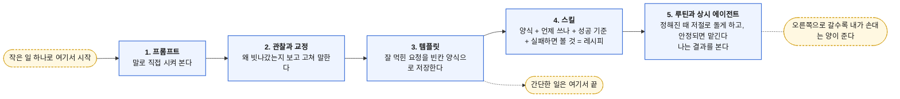
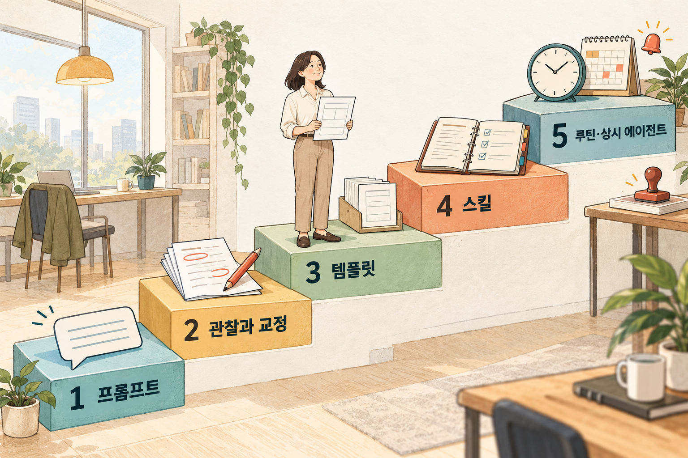

# 1. AI 활용 사다리 — 작은 일 하나로 한 칸씩

> [목차](index.md) · 이전: [1주차 8. 일을 맡기는 도구의 보안 — 숨은 지시](../1-week/08-보안-3.md) · 다음: [2. 말로 시키고, 보고 고친다](02-프롬프트.md)
>
> 2주차 첫 시간이다.

## 이 시간의 목표

AI 활용 사다리 다섯 칸의 이름과 순서를 말하고, 내 업무가 지금 몇 번째 칸에 있는지 짚을 수 있다.

## 핵심 한 줄

**실망은 대개 AI의 능력 부족이 아니라, 너무 높은 칸에서 시작한 결과다.**

## 용어

- **에이전트**: 답만 하는 데서 그치지 않고, 검색·메일·파일 같은 도구를 직접 써서 일을 끝까지 처리하는 AI다. 1주차 [3](../1-week/03-도구용어.md)에서 본 하네스가 도구를 쥐여 준 상태다.
- **승인 게이트**: 보내기·결제·삭제처럼 되돌리기 어려운 행동 직전에, 사람이 확인 버튼을 눌러야 다음으로 넘어가는 관문이다.

나머지 용어(템플릿, 스킬, 루틴)는 그 칸에서 정의한다.

## 왜 사다리인가

에이전트 소식을 들으면 이런 상상을 한다. "내 메일을 알아서 정리하고, 장도 봐 주고, 일정도 잡아 주겠구나." 그래서 첫날부터 "내 일주일을 관리해 줘"라고 맡긴다. 결과는 대부분 실망스럽다.

신입 직원에게 첫날 "회사 일 알아서 다 해 주세요"라고 하는 것과 같다. 아무리 똑똑해도 우리 집 사정, 내 취향, 우리 가게의 규칙을 모르면 일을 제대로 못 한다. AI도 같다. 1주차 [5](../1-week/05-프롬프트.md)의 말로 하면, 모델은 좋아져도 **내 상황은 여전히 모른다.**

그래서 나는 AI 쓰는 법을 다섯 칸짜리 사다리로 정리한다.

*나는 작은 일 하나로 시작하고, 그 일에 맞는 칸에서 멈춘다.*

## 사다리의 세 가지 규칙

1. **아래에서 위로 올라간다.** 처음부터 상시 에이전트를 만들지 않는다.
2. **한 번에 한 칸씩, 작은 일 하나로 시작한다.** 일 하나로 사다리를 끝까지 올라가 본 경험이, 일 열 개를 1단계에서 맴도는 것보다 값지다.
3. **모든 일이 꼭대기까지 갈 필요는 없다.** 일의 무게에 맞춰 멈출 칸을 고른다. 생일 축하 문자는 3단계면 충분하다.

AI 회사들의 안내도 같은 방향이다. Anthropic은 에이전트 설계 글에서 가장 단순한 방법부터 시작하고, 필요할 때만 복잡도를 올리라고 권한다. 여기서부터는 내 해석이다. 그 글은 개발자에게 하는 말이지만, 일반 사용자에게도 그대로 맞는다. 단순한 칸에서 잘 안 되는 일은 높은 칸에서도 잘 안 된다. 틀린 방법을 빠르게 반복할 뿐이다.

## 칸마다 무엇이 달라지나

같은 식단 일로 보면 이렇다.

| 칸 | 내가 하는 말 | 내가 기억해야 하는 것 | 내가 하는 일 |
| --- | --- | --- | --- |
| 1. 프롬프트 | "이번 주 저녁 메뉴 짜 줘" | 전부 | 묻고, 읽고, 판단한다 |
| 2. 관찰과 교정 | 조건 다섯 줄을 더한다 | 우리 집 조건 전부 | 비교하고 고쳐 말한다 |
| 3. 템플릿 | 양식을 붙여 넣고 빈칸 네 개를 채운다 | 양식의 위치, 확인할 점 | 빈칸 채우기, 결과 확인 |
| 4. 스킬 | "이번 주 식단 짜 줘" | 거의 없음 | 성공 기준을 지켰는지 가끔 확인 |
| 5-1. 루틴 | (말 안 함. 일요일 저녁 6시에 저절로) | 없음 | 예산·일정에 답하고 결제를 승인한다 |
| 5-2. 상시 에이전트 | (말 안 함. 일정이 바뀌면 알아서 조정) | 없음 | 알림 확인, 결제 승인, 월 1회 점검 |

마지막 열을 눈여겨본다. 어느 칸에서도 "아무것도 안 함"은 없다. 위로 갈수록 나는 **일하는 사람에서 결과를 확인하는 사람**으로 바뀐다.

## 신입 직원을 들이듯

Anthropic은 스킬을 소개하면서, 에이전트에게 스킬을 만들어 주는 일을 신입 직원의 온보딩 안내서를 만드는 일에 비유했다. 나는 이 비유를 사다리 전체로 넓혀 쓴다. 여기서부터는 내 해석이다.

| 온보딩 | 사다리 | 신입에게는 | AI에게는 | 믿는 정도 |
| --- | --- | --- | --- | --- |
| ① 지켜보기 | 1. 프롬프트 | 간단한 일을 시켜 보고 일하는 방식을 본다 | 일단 시켜 보고 잘하는 것과 못하는 것을 본다 | 아직 없다. 전부 확인 |
| ② 가르쳐 주기 | 2. 관찰과 교정 | "우리는 이렇게 해요"라고 고쳐 준다 | 빗나간 이유를 찾아 조건을 말해 준다 | 조금. 매번 확인 |
| ③ 문서화 | 3. 템플릿 | 자주 쓰는 양식을 준다 | 빈칸 양식을 저장한다 | 형식은 믿는다. 내용은 확인 |
| | 4. 스킬 | 업무 매뉴얼을 준다 | 절차 전체를 레시피로 묶는다 | 절차는 믿는다. 결과는 가끔 확인 |
| ④ 맡기기 | 5-1. 루틴 | "매주 금요일 이거 담당"이라고 정기 업무를 준다 | 스킬을 예약 실행한다 | 대부분 믿는다. 중요한 결정은 승인 |
| | 5-2. 상시 에이전트 | 한 분야의 담당자로 세운다 | 담당 범위를 맡긴다 | 범위 안에서 믿는다. 돈·대외 행동은 승인 |

비유에서 가져갈 것은 셋이다.

- **결재권은 천천히 준다.** 입사 첫 주에 회사 카드와 대표 메일 발송 권한을 주지 않는다. AI의 결제·발송도 같다.
- **좋은 매뉴얼이 좋은 직원을 만든다.** 4단계 스킬이 그 매뉴얼이다.
- **베테랑에게도 정기 면담은 있다.** 상시 에이전트에게 맡겨도 월 1회 점검은 계속한다.

### 비유가 맞지 않는 곳

비유는 설명을 돕지만 다 맞지는 않는다. 다른 곳이 오히려 중요하다.

- 사람은 회의 중에 눈치로 맥락을 배운다. **AI는 내가 글로 주거나 연결해 준 것만 안다.** 그래서 문서화가 사람보다 AI에게 더 중요하다.
- 사람은 한 번 배운 것을 대체로 기억한다. AI는 **저장된 지침·스킬·메모리 기능이 없으면 대화가 끝날 때 잊는다.** 3·4단계에서 "저장"을 강조하는 이유다.
- 사람은 이상하면 스스로 멈추고 묻는다. AI는 **"멈추고 물어라"를 적어 줘야** 그렇게 한다.

## 1주차와 이어지는 곳

1주차 [1](../1-week/01-LLM구조.md)의 네 가지 어긋남(지어내기·더하기·빠뜨리기·바꾸기)은 사다리의 모든 칸에서 다시 나온다. 칸마다 막는 방법이 다를 뿐이다.

| 칸 | 어긋남을 막는 방법 |
| --- | --- |
| 1·2 | 내가 읽고 고쳐 말한다 |
| 3 | 막는 문장("메모에 없는 내용은 더하지 않는다")을 양식에 박아 둔다 |
| 4 | 성공 기준과 "자료가 없으면 지어내지 말고 알려라"를 적는다 |
| 5 | 승인 게이트를 두고, 결과를 정해진 때 확인한다 |

1주차 [6~8](../1-week/06-보안-1.md)의 보안은 위로 갈수록 무거워진다. 5단계에서 AI는 내가 보지 않는 동안 메일과 웹을 읽는다. 1주차 [8](../1-week/08-보안-3.md)의 숨은 지시가 실제 위험이 되는 칸이다.

## 실습: 내 업무는 몇 번째 칸인가 (5분)

1주차 과제로 고른 내 업무를 적는다. 아래 세 질문에 답하고, 지금 칸과 멈출 칸을 정한다.

| 질문 | 내 답 |
| --- | --- |
| 얼마나 자주 하나? (한 번 / 가끔 / 매주·매달) | |
| 틀리면 얼마나 손해인가? (거의 없음 / 돈·관계·신뢰) | |
| 몇 단계짜리 일인가? (한 번 묻고 끝 / 모으고 정리하고 확인) | |
| 지금 칸 | |
| 오늘 목표로 할 칸 | |

대략의 기준은 이렇다. 한 번뿐이면 1~2단계, 가끔이면 3단계, 정기적이고 여러 단계면 4~5단계다. 틀렸을 때 손해가 크면 칸과 상관없이 승인 게이트를 둔다.

> ✍️ **[채우기]** 내가 너무 높은 칸에서 시작했다가 실망한 일 하나. 무엇을 맡겼고, 어디서 틀렸고, 몇 번째 칸으로 내려와서 다시 했는지.

## 정리

- AI 활용 사다리는 프롬프트 → 관찰과 교정 → 템플릿 → 스킬 → 루틴·상시 에이전트의 다섯 칸이다.
- 아래에서 위로, 일 하나로 한 칸씩, 일의 무게에 맞는 칸에서 멈춘다.
- 위로 갈수록 나는 일하는 사람에서 확인하는 사람이 된다. 확인을 그만두지는 않는다.
- AI는 글로 준 것만 알고, 저장하지 않으면 잊고, 적어 주지 않으면 멈추지 않는다.

## 참고

- [AI 활용 사다리 가이드](../1-week/ai-adoption-ladder-guide-ko.md) 1장(서론), 5장(식단 예시로 본 변화), 6장(온보딩 비유)
- [Building effective agents](https://www.anthropic.com/engineering/building-effective-agents) (Anthropic, 2024년 12월, 영문)
- [Equipping agents for the real world with Agent Skills](https://www.anthropic.com/engineering/equipping-agents-for-the-real-world-with-agent-skills) (Anthropic, 2025년 10월, 영문)
