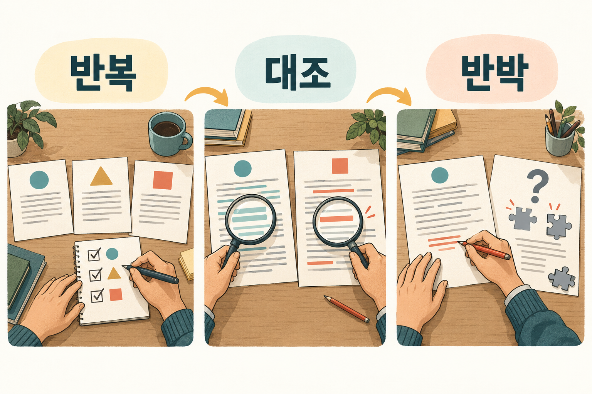

# 3. 프롬프트를 실험처럼 — 사다리 2단계 심화

> [목차](index.md) · 이전: [2. 말로 시키고, 보고 고친다](02-프롬프트.md) · 다음: [4. 잘 먹힌 말을 빈칸 양식으로](04-템플릿.md)
>
> 1주차에 다루지 못한 프롬프트 심화다. 출발점은 James M. Dewar의 Nature 칼럼이다. 칼럼의 요령을 내 말로 줄이고, 우리 수업의 예시에 맞게 다시 묶었다.

## 이 시간의 목표

같은 요청을 여러 번 돌려 보고, 결과를 원문과 대조하고, AI에게 내 생각의 약점을 찾게 할 수 있다.

## 핵심 한 줄

**한 번 나온 답은 결과 하나일 뿐이다. 반복하고, 대조하고, 반박하게 한다.**

## 용어

- **메타 프롬프팅**: 원하는 일을 쉬운 말로 설명하고, 그 일을 시킬 프롬프트를 AI에게 대신 쓰게 하는 방법이다.
- **커넥터**: AI가 내 메일, 드라이브, 문헌 데이터베이스 같은 바깥 서비스에 접근하게 연결해 주는 장치다. 1주차 [3](../1-week/03-도구용어.md)에서 본 하네스의 도구다. Claude에서는 커넥터, ChatGPT에서는 앱이라고 부른다.

## 칼럼이 말하는 것

Dewar는 밴더빌트 대학교에서 DNA 복제와 복구를 연구하는 생화학자다. 생의학 박사과정 신입생에게 AI 수업을 했다. 칼럼에 따르면 수업 전에는 81%가 연구에 AI를 써 봤지만, 기본 수준의 프롬프트 실력을 갖춘 학생은 5%였다. 수업 뒤에는 48%가 되었다.

그의 요지는 하나다. **프롬프트 하나를 실험 하나로, 출력을 실험 결과로 다루라.** 그리고 AI를 잘 쓰는 데 컴퓨터 배경은 필요 없고, 이미 가진 과학 훈련을 쓰면 된다고 말한다.

여기서부터는 내 해석이다. 우리 수강생 대부분은 과학자가 아니다. 그래도 이 말은 그대로 통한다. 실험의 핵심은 "한 번 본 것을 믿지 않는다"이고, 이것은 1주차 내내 한 말과 같다. 2에서 본 "한두 가지씩 고친다"도 실험의 원리다. 한 번에 하나만 바꿔야 무엇이 효과였는지 안다.

칼럼의 열 가지 요령을 나는 실험의 순서대로 네 묶음으로 나눈다.

| 묶음 | 요령 | 사다리 |
| --- | --- | --- |
| 실험 전에 | 도구를 먼저 연결한다 · 입력에 구조를 준다 | 2단계 |
| 실험하면서 | AI에게 프롬프트를 쓰게 한다 · 검증된 프롬프트에서 시작한다 · 대화를 짧게 둔다 · 잘 되던 지점으로 돌아간다 | 2단계 |
| 실험 뒤에 | 다시 해 봐도 같은지 본다 · 맞는지 본다 · 틀렸다고 말해 달라고 한다 | 2단계 |
| 남기기 | 잘 통한 프롬프트를 모아 둔다 | 3단계로 ([4](04-템플릿.md)) |

## 실험 전에

### 도구를 먼저 연결한다

AI는 닿을 수 있는 것에 대해서만 따질 수 있다. 칼럼은 웹 검색을 최소한으로 보고, 생의학 연구라면 PubMed 같은 문헌 도구를 연결하라고 권한다. 그러면 답이 출판된 연구에 기댄다.

일반 사용자에게 옮기면 이렇다. 가게 영업시간이나 요즘 가격을 물을 때는 **검색이 켜진 상태**에서 묻는다. 내 문서를 바탕으로 답해야 하면 문서를 붙이거나 드라이브를 연결한다. 1주차 [2](../1-week/02-LLM발전.md)에서 본 "찾아보기"를 내 쪽에서 켜는 일이다.

연결할 때는 1주차 [7](../1-week/07-보안-2.md)의 기준을 그대로 쓴다. 필요한 서비스만, 읽기부터 연다.

### 입력에 구조를 준다

칼럼은 구조 없는 글보다 구조 있는 글을 AI가 더 잘 읽는다고 말하고, 대개 마크다운이면 충분하다고 한다. **마크다운**은 `#` 제목, `-` 목록처럼 기호 몇 개로 글에 모양을 주는 방법이다.

우리가 2에서 쓴 `[목적] [자료] [조건] [결과 형식]` 이름표와 `--- 메모 시작 ---` 표시가 이미 구조다. 더 배울 것은 없다. 긴 자료를 여러 개 붙일 때 이름표를 빼먹지 않으면 된다.

## 실험하면서

### AI에게 프롬프트를 쓰게 한다

칼럼은 이것을 실험실에서 제조사 프로토콜로 시작하는 것에 비유한다. 원하는 것을 쉬운 말로 설명하고, 그 일을 시킬 프롬프트를 AI가 쓰게 한 뒤, **그 프롬프트를 새 대화에서** 돌린다.

연구 개발자라면 이렇게 쓸 수 있다. 아래는 칼럼의 예를 내가 줄여 옮긴 것이다.

```text
Claude에 넣을 프롬프트를 만들어 줘. 그 프롬프트는 내가 주는 논문을 요약하게 해야 한다.
서론·결과·논의를 따로 요약하고, 저자가 인정한 한계를 짚고,
결론이 근거로 뒷받침되는지 따져 보게 해야 한다.
```

가게를 하는 분이라면 이렇게 쓴다.

```text
ChatGPT에 넣을 프롬프트를 만들어 줘. 그 프롬프트는 내가 붙여 넣는 구글 리뷰에
답글 초안을 쓰게 해야 한다. 나는 휴스턴에서 한식당을 한다.
네 칸(목적·자료·조건·결과 형식)으로 쓰고, 환불이나 보상은 약속하지 않게 해 줘.
```

여기서부터는 내 해석이다. 메타 프롬프팅은 편하지만, 나온 프롬프트를 **내가 한 번 읽고** 쓴다. AI는 내 상황을 모르는 채로 빈칸을 그럴듯하게 채울 수 있다. 우리 수업의 [네 칸 요청 스킬](../skills/four-part-prompt/SKILL.md)은 이 일을 하되, 모르는 사실은 먼저 묻게 만든 것이다. 5에서 다시 본다.

### 검증된 프롬프트에서 시작한다

연구자가 모든 방법을 새로 만들지 않고 출판된 프로토콜에서 시작하듯, 남이 이미 써 보고 다듬은 프롬프트에서 시작할 수 있다. Dewar는 학술 작업용 프롬프트 모음을 Zenodo에 무료로 공개해 두었다.

남의 프롬프트를 빌려도 2단계는 거친다. **내 상황에 맞는지 몇 번 돌려 본 뒤** 쓴다.

### 대화를 짧게 둔다

칼럼은 대화가 길어질수록 AI가 덜 믿을 만해진다는 연구(Laban 외, 2025)를 근거로 든다. 그리고 한번 나온 말은 대화 안에서 지울 수 없다.

칼럼이 권하는 방법은 2에서 본 것과 같다. 한 대화에서 일을 다듬고, 그 결과를 프롬프트 하나로 줄여 달라고 한 뒤, 새 대화에서 돌린다.

### 잘 되던 지점으로 돌아간다

대화가 중간에 나빠질 때가 있다. 지시를 무시하는 것처럼 보이거나, 같은 실수를 계속 고쳐 줘야 한다. 칼럼은 AI가 긴 글의 중간보다 처음과 끝을 더 잘 쓴다는 연구(Liu 외, 2023)를 이유로 든다.

이때는 앞 메시지를 고친다. ChatGPT와 Claude 모두 내가 보낸 메시지를 편집해 다시 보낼 수 있다. 그러면 **실수가 나오기 전 지점에서 대화가 갈라져 나간다.** 실수가 섞인 대화를 계속 끌고 가는 것보다 낫다.

## 실험 뒤에



*나는 여러 번 같은 답이 나와도 원문과 대조하고, 내 생각의 약점도 묻는다.*

### 다시 해 봐도 같은지 본다

같은 요청에도 답이 매번 조금씩 다를 수 있다. 칼럼은 같은 프롬프트를 서로 다른 대화에서 여러 번 돌려 보라고 한다. 실험실의 반복 실험이다. 여러 번 나오는 내용은 믿을 만한 쪽이고, 한 번만 나온 내용은 우연일 수 있다.

반복에는 다른 쓸모도 있다. 돌릴 때마다 새 답이 나오면 **아직 다 본 것이 아니다.** 아이디어나 후보를 모을 때 특히 그렇다.

### 맞는지 본다

여러 번 같다고 맞는 것은 아니다. 같은 틀린 답이 세 번 나올 수도 있다. 칼럼은 사람이 확인하는 것이 여전히 가장 확실한 기준이라고 말한다.

양이 많으면 칼럼의 방법을 쓴다. 결과를 **새 대화**에 복사해 넣고, 원문과 대조해 감사하게 한다. 완벽하지는 않지만 첫 답을 그대로 받는 것보다 낫다. 그래도 마지막 대조는 내가 한다. 1주차 [7](../1-week/07-보안-2.md#결과에도-확인할-것이-있다)의 자동화 편향, 즉 기계가 낸 답을 덜 의심하는 경향을 기억한다.

```text
--- 원문 시작 ---
(회의 메모)
--- 원문 끝 ---

--- 요약 시작 ---
(다른 대화에서 받은 회의록)
--- 요약 끝 ---

요약의 문장마다 원문에 근거가 있는지 표로 확인해 줘.
열: 요약 문장 | 원문 근거(그대로 인용) | 판정(있음 / 없음 / 바뀜)
원문에 없는 내용은 "없음"으로 표시하고, 고쳐 쓰지는 마.
```

### 틀렸다고 말해 달라고 한다

AI는 도움이 되도록 만들어져서 맞장구를 지나치게 칠 수 있다. 칼럼은 이 약점을 뒤집어 쓰라고 한다. 내 추론과 계획을 엄하게 비판해 달라고 하면 열심히 한다.

Dewar의 연구실에서는 쉽지 않은 실험을 시작하기 전에, 그 실험을 **하지 말아야 할 가장 강한 이유**를 AI에게 먼저 만들어 달라고 한다. 칼럼에 따르면 이것으로 시간과 시약 비용을 꽤 아꼈다.

우리 수업의 예로 옮기면 이렇다.

```text
나는 휴스턴에서 한식당을 한다. 다음 달부터 평일 점심에 단골 10% 할인을 하려고 한다.
이 계획을 하지 말아야 할 가장 강한 이유 세 가지를 말해 줘.
듣기 좋은 말은 빼고, 각 이유마다 내가 확인해 볼 숫자를 하나씩 붙여 줘.
```

여기서부터는 내 해석이다. 반박을 받았다고 계획을 버릴 필요는 없다. 내가 미처 생각 못 한 질문 목록을 얻는 것이다. 답은 여전히 내가 낸다.

## 시연: 같은 요청, 세 번 (10분)

2의 빵집 네 칸 요청을 새 대화 세 개에 각각 넣는다. 수강생과 함께 표를 채운다.

| | 1회 | 2회 | 3회 |
| --- | --- | --- | --- |
| 휴무 날짜가 자료와 같은가 | | | |
| 다섯 줄 안인가 | | | |
| 보상을 약속하지 않았나 | | | |
| 세 번 다 나온 표현 | | | |
| 한 번만 나온 표현 | | | |

수강생에게 묻는다. 세 번 다 지켜진 조건과 한 번이라도 어긴 조건은 무엇인가? 어긴 조건은 요청서에서 어떻게 고쳐야 할까?

> ✍️ **[채우기]** 내가 같은 요청을 여러 번 돌려 보거나, AI에게 반박을 시켜서 실제로 생각을 바꾼 일 하나.

## 실습: 내 결과 감사하기 (10분)

2에서 만든 내 네 칸 요청으로 한다.

1. 새 대화 두 개에 같은 요청을 넣는다. 두 결과에서 다른 점을 적는다.
2. 결과 하나를 세 번째 새 대화에 원문과 함께 넣고 감사를 시킨다.
3. 감사 결과 중 하나를 골라 내가 원문을 직접 열어 맞는지 본다.

| | 적을 것 |
| --- | --- |
| 두 결과에서 다른 점 | |
| 감사가 "없음"이나 "바뀜"으로 표시한 것 | |
| 내가 원문에서 확인한 결과 | |
| 요청서에서 고칠 줄 | |

## 정리

- 프롬프트는 실험이고, 출력은 결과다. 한 번 본 결과를 믿지 않는다.
- 실험 전에는 도구를 연결하고 구조를 준다. 실험하면서는 대화를 짧게, 나빠지면 돌아간다.
- 실험 뒤에는 반복해 보고, 대조해 보고, 반박하게 한다. 마지막 대조는 내가 한다.
- 잘 통한 프롬프트는 모아 둔다. 그것이 다음 칸인 템플릿이다.

## 참고

- James M. Dewar, [Want to get more from AI? Treat every prompt like an experiment](https://doi.org/10.1038/d41586-026-02083-6), *Nature* Career Column, 2026년 8월 3일 (영문). 강의 준비용 번역은 [1주차 참고/프롬프트실험.md](../1-week/참고/프롬프트실험.md)에 있다. 수강생에게는 원문 링크만 준다
- Dewar, J. M., [학술 작업용 프롬프트 모음](https://doi.org/10.5281/zenodo.19177101) (Zenodo, 2026, 영문)
- Laban, P. 외, [LLMs get lost in multi-turn conversation](https://doi.org/10.48550/arXiv.2505.06120) (arXiv, 2025, 영문)
- Liu, N. F. 외, [Lost in the middle](https://doi.org/10.48550/arXiv.2307.03172) (arXiv, 2023, 영문)
