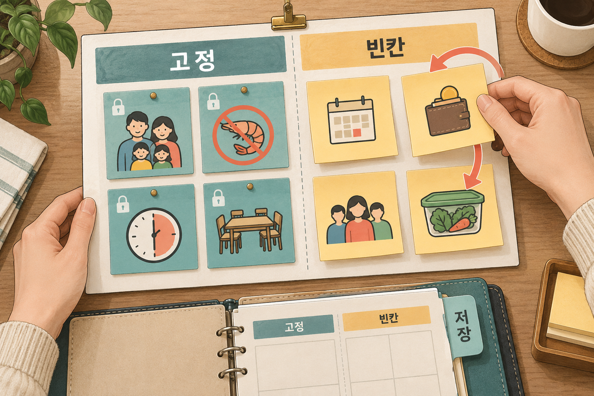

# 4. 잘 먹힌 말을 빈칸 양식으로 — 사다리 3단계

> [목차](index.md) · 이전: [3. 프롬프트를 실험처럼](03-실험.md) · 다음: [5. 절차 전체를 레시피로](05-스킬.md)

## 이 시간의 목표

2·3에서 다듬은 요청을 빈칸 양식으로 바꾸고, 다시 찾을 수 있는 한 곳에 저장할 수 있다.

## 핵심 한 줄

**템플릿은 2단계에서 고생해서 얻은 깨달음을 잃어버리지 않게 붙잡아 두는 그릇이다.**

## 용어

- **템플릿**: 빈칸이 뚫린 양식이다. 매번 날짜·금액·이름 같은 빈칸만 바꿔 쓰는 요청이다.
- **스니펫**: 저장해 둔 글 조각이다. 내가 직접 꺼내 붙여 넣어야 쓸 수 있다. 템플릿을 메모 앱에 넣어 두면 스니펫이 된다.

## 왜 저장하나

2에서 나는 식단 요청에 조건 다섯 줄을 더했다. 3에서는 그 요청을 세 번 돌려 보고, 어긴 조건을 고쳤다. 다음 주에 이걸 처음부터 다시 쓰면 그 고생을 또 한다. 템플릿으로 남기면 세 가지가 달라진다.

- 조건을 처음부터 다시 쓰는 수고가 없다.
- 결과의 품질이 들쭉날쭉하지 않다. 매번 같은 조건이 들어가기 때문이다.
- 가족이나 동료에게 "이거 복사해서 쓰면 돼"라고 나눠 줄 수 있다.

칼럼의 마지막 요령도 같은 말이다. Dewar는 잘 통하는 프롬프트를 잘 통하는 실험 프로토콜처럼 다루라고 한다. 저장하고, 버전을 남기고, 시간을 두고 다듬으라고 한다.

## 만드는 법: 고정과 빈칸을 나눈다

다듬은 요청을 놓고 줄마다 묻는다. **이 줄은 다음 주에도 그대로인가?**

| 다음 주에도 그대로 (고정) | 매번 바뀐다 (빈칸) |
| --- | --- |
| 가족 구성, 알레르기 | 기간 |
| 평일 30분 조건 | 이번 주 예산 |
| 같은 주재료 3일 연속 금지 | 외식·손님 일정 |
| 결과 모양 | 남은 재료 |

고정은 그대로 두고, 빈칸만 `[ ]`로 표시한다.



*나는 지킬 조건은 고정하고, 이번에 달라진 정보만 빈칸에 넣는다.*

### 시연: 식단 템플릿

아래는 설명을 위해 만든 예시다.

```text
[주간 저녁 식단 + 장보기 목록]

기간: [11월 9일(월) ~ 11월 15일(일)]
가족: 어른 2, 초등학생 2. 둘째는 갑각류(새우·게) 알레르기.
이번 주 예산: [$200]
이번 주 특이사항: [수요일은 외식, 토요일 점심에 손님 2명 추가]
집에 남아 있는 재료: [양파 3개, 두부 1모, 냉동 닭가슴살 1 lb]

조건:
- 평일 저녁은 30분 안에 만들 수 있는 것
- 같은 주재료가 3일 연속 나오지 않게
- 남은 재료를 먼저 쓰는 메뉴로 시작
- 가격은 대략으로. 모르는 가격은 지어내지 말고 "확인 필요"로 표시

결과 형식:
1) 요일별 표 (요일 | 메뉴 | 조리 시간 | 주재료)
2) 장볼 목록: H-E-B와 H Mart로 나누고, 품목마다 수량
3) 예상 총액 (대략)

정보가 부족하면 쓰기 전에 먼저 물어봐 줘.
```

다음 주에는 빈칸 네 개만 바꿔 붙여 넣는다. "모르는 가격은 지어내지 말고"는 3에서 결과를 감사하다가 더한 줄이라고 하자. **이런 줄이 템플릿의 값어치다.** 처음 쓸 때는 몰랐고, 해 보고 나서 안 것이다.

### 시연: 보고 메일 템플릿

```text
[주간 업무 보고 메일]

받는 사람: [김 팀장님]
보고 주간: [11월 9일 ~ 11월 13일]
이번 주 한 일: [목록]
이슈·도움 필요: [없으면 "없음"]
다음 주 계획: [목록]

규칙:
- 휴대폰 한 화면 분량, "~했습니다" 체
- 제목은 "[주간보고] 이름 / 날짜"
- 내가 적지 않은 일이나 숫자는 더하지 않는다
```

## 좋은 템플릿의 조건

- **빈칸은 세~다섯 개.** 빈칸이 열다섯 개면 채우는 일이 처음부터 쓰는 것보다 귀찮다.
- **막는 문장은 고정 칸에.** "지어내지 말 것", "더하지 말 것"은 매번 바뀌지 않는다. 빈칸에 두면 빠뜨린다.
- **끝 줄은 늘 같다.** "정보가 부족하면 쓰기 전에 먼저 물어봐 줘." 빈칸을 깜빡해도 AI가 지어내지 않고 묻게 하는 장치다.
- **이름과 날짜를 붙인다.** "식단 템플릿 v2 (11월 9일, 가격 줄 추가)". 무엇을 왜 고쳤는지 남긴다.

## 어디에 저장하나

찾지 못하는 템플릿은 없는 것과 같다. 나는 **한 곳에** 모은다.

| 저장하는 곳 | 좋은 점 | 아쉬운 점 |
| --- | --- | --- |
| 휴대폰·컴퓨터의 메모 앱에 "AI 템플릿" 폴더 하나 | 어느 AI에나 붙여 넣을 수 있다 | 내가 꺼내 붙여야 한다 |
| AI 앱의 프로젝트 지침 | 그 프로젝트의 대화에 자동으로 붙는다 | 그 앱, 그 프로젝트 안에서만 쓴다 |

여기서부터는 내 해석이다. 처음에는 메모 앱이 낫다. 한 앱에 묶이지 않고, 1주차에 본 것처럼 일에 따라 ChatGPT와 Claude를 오가기 때문이다. 같은 템플릿을 두 앱에 넣어 결과를 비교해 볼 수도 있다. 프로젝트 지침으로 옮기는 것은 3주차 [8](../2-3-week/08-지침과내업무.md)에서 한다.

## 3단계에서 멈춰도 되는 일

간단하고, 가끔 하고, 틀려도 손해가 적은 일은 여기서 끝낸다. 템플릿만으로 충분하다.

- 생일·명절 축하 문자
- 중고 거래 판매글(Facebook Marketplace, 한인 커뮤니티 게시판)
- 모임 안내 문자
- 가게 휴무 공지

3단계에서도 **빈칸 채우기와 결과 읽기는 여전히 내가 한다.**

## 흔한 실수

| 실수 | 왜 문제인가 | 이렇게 한다 |
| --- | --- | --- |
| 두 번 해 본 것을 바로 템플릿으로 | 아직 패턴이 안정되지 않았다 | 2단계에서 두 번 연속 만족한 뒤에 |
| 빈칸이 너무 많다 | 채우는 게 처음부터 쓰는 것보다 귀찮다 | 빈칸은 세~다섯 개, 나머지는 고정 |
| 템플릿이 여기저기 흩어진다 | 못 찾으면 결국 다시 쓴다 | 한 폴더에 모은다 |
| 상황이 바뀌어도 안 고친다 | 아이가 알레르기를 졸업했는데 계속 빠진다 | 석 달에 한 번 훑어본다 |

## 실습: 내 템플릿 만들기 (10분)

2·3에서 다듬은 내 요청으로 한다.

1. 요청의 줄마다 "다음에도 그대로인가?"를 묻고 고정과 빈칸으로 나눈다.
2. 빈칸을 `[ ]`로 표시하고, 끝 줄 "정보가 부족하면 쓰기 전에 먼저 물어봐 줘."를 붙인다.
3. 메모 앱에 "AI 템플릿" 폴더를 만들고 이름과 날짜를 붙여 저장한다.
4. 빈칸을 다른 값으로 채워 새 대화에서 한 번 돌려 본다.

| | 적을 것 |
| --- | --- |
| 템플릿 이름 | |
| 빈칸 (세~다섯 개) | |
| 해 보고 나서 더한 막는 문장 | |
| 저장한 곳 | |

이것이 2주차 과제의 시작이다. 3주차 전까지 이 템플릿을 실제로 두세 번 써 보고, 고친 점을 적어 온다.

> ✍️ **[채우기]** 내가 실제로 저장해 두고 쓰는 템플릿 하나. 어디에 저장했고, 몇 번째 버전이며, 마지막으로 고친 줄은 무엇인지.

## 다음 칸으로 갈 신호

3단계에서 4단계로 올라가도 되는 신호는 이렇다. 둘 이상이면 올라간다.

- 템플릿을 붙여 넣은 뒤 **매번 같은 확인을 한다.** 예: "새우 들어간 거 없나?"
- 실패했을 때 어떻게 할지가 정해져 있다.
- 다른 사람이 해도 같은 결과가 나와야 한다.
- 여러 단계(모으기 → 정리 → 확인)가 이어진다.

한 번 쓰고 끝나는 단순한 일이거나, 성공 기준을 글로 쓸 수 없다면 아직 이르다.

## 정리

- 템플릿은 다듬은 요청에서 고정과 빈칸을 나눈 양식이다.
- 막는 문장은 고정 칸에 두고, 끝 줄은 늘 "모르면 먼저 물어봐 줘"다.
- 한 곳에 모으고 이름과 날짜를 붙인다. 못 찾으면 없는 것과 같다.
- 간단한 일은 여기서 멈춘다. 매번 같은 확인을 하게 되면 다음 칸으로 간다.

## 참고

- [AI 활용 사다리 가이드](../1-week/ai-adoption-ladder-guide-ko.md) 2장의 3단계, 3장의 전환 기준, 4장의 흔한 실수
- James M. Dewar, [Want to get more from AI? Treat every prompt like an experiment](https://doi.org/10.1038/d41586-026-02083-6), *Nature*, 2026년 8월 3일 (영문). 10번째 요령 "프롬프트 라이브러리를 만들어라"
