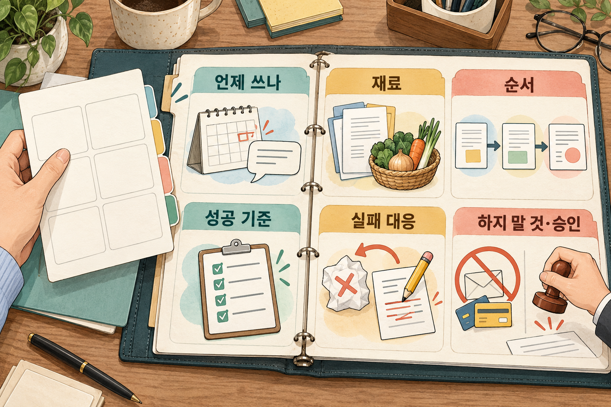

# 5. 절차 전체를 레시피로 — 사다리 4단계

> [목차](index.md) · 이전: [4. 잘 먹힌 말을 빈칸 양식으로](04-템플릿.md) · 다음: [6. 루틴과 상시 에이전트](06-루틴.md)

## 이 시간의 목표

템플릿과 스킬의 차이를 말하고, 내 템플릿에 성공 기준과 실패 대응을 더해 스킬 초안 한 장을 쓸 수 있다.

## 핵심 한 줄

**템플릿은 "무엇을 말할지"를 저장하고, 스킬은 "이 일을 어떻게 끝내는지"를 저장한다.**

## 용어

- **스킬**: 지시, 양식, 예시, 확인할 것을 한 묶음으로 저장해 두고 AI가 필요할 때 꺼내 쓰게 하는 것이다. 일에 대한 레시피 카드라고 생각하면 된다.
- **성공 기준**: 결과가 이렇게 되면 합격이라는, 확인할 수 있는 문장이다. "맛있게"는 성공 기준이 아니다. "갑각류 0개"는 성공 기준이다.

## 템플릿과 스킬은 어떻게 다른가

| | 템플릿(스니펫) | 스킬 |
| --- | --- | --- |
| 꺼내는 쪽 | **내가** 찾아서 붙여 넣는다 | **AI가** 요청을 보고 꺼내 쓴다 |
| 담긴 것 | 요청 문장 | 언제 쓰나 + 재료 + 순서 + 성공 기준 + 실패 대응 + 하지 말 것 |
| 실패했을 때 | 내가 알아채고 다시 물어야 한다 | 스킬 안에 "이럴 땐 이걸 확인"이 적혀 있다 |
| 비유 | 요리책에서 찢어 낸 재료 목록 한 장 | 재료, 순서, 완성 사진, "탔으면 이렇게"까지 있는 레시피 카드 |

4에서 본 신호를 다시 본다. 템플릿을 붙여 넣은 뒤 **매번 같은 확인을 한다면**, 그 확인을 내 머리가 아니라 스킬에 적어 둘 때다.

Anthropic은 같은 요청을 여러 대화에서 반복해서 치고 있다면 스킬을 만들 때라고 안내한다. 1에서 본 대로, 스킬을 신입 직원의 온보딩 안내서에 비유하기도 했다.

## 좋은 스킬에 들어가는 여섯 가지

1. **언제 쓰나**: 어떤 말이나 상황에서 꺼내는가
2. **재료**: 고정된 정보, 매번 물어볼 정보, 필요한 연결
3. **순서**: 무엇부터 하는가
4. **성공 기준**: 모두 통과해야 끝이다
5. **실패하면 볼 것**: 기준에 걸리면 어떻게 하는가
6. **하지 말 것과 승인**: 절대 안 할 것, 내 확인을 받을 것



*나는 요청 문장에 끝내는 기준과 실패했을 때 할 일까지 더한다.*

5와 6이 템플릿에 없던 칸이다. 1에서 말한 "AI는 멈추라고 적어 줘야 멈춘다"가 여기에 들어간다.

## 시연: 식단 스킬

4의 식단 템플릿을 스킬로 키운다. 아래는 설명을 위해 만든 예시다. 사람이 읽어도, AI가 읽어도 이해되게 쓴다.

```text
# 스킬 이름: 주간 가족 식단과 장보기 목록

## 언제 쓰나
- "이번 주 식단", "장보기 목록", "다음 주 메뉴"라고 할 때

## 재료
- 고정: 어른 2, 초등학생 2. 둘째는 갑각류 알레르기. 평일 저녁은 30분 안.
- 매번 물어볼 것: 예산, 외식·손님 일정, 남은 재료
  (말하지 않으면 "지난주와 같음"으로 가정하고, 가정했다고 적는다)

## 순서
1. 남은 재료를 먼저 쓰는 메뉴로 월·화를 채운다.
2. 평일은 30분 이하 메뉴만 고른다.
3. 같은 주재료가 3일 연속 나오지 않게 한다.
4. 요일별 표를 만든다.
5. 장볼 목록을 H-E-B와 H Mart로 나누고 수량을 붙인다.
6. 예상 총액을 계산한다.

## 성공 기준 (모두 통과해야 끝)
- [ ] 갑각류(새우, 게, 랍스터, 크로피시, 새우젓 포함)가 하나도 없다
- [ ] 예상 총액이 예산 안이다
- [ ] 평일 메뉴의 조리 시간이 모두 30분 이하다
- [ ] 장볼 목록의 재료가 모두 표의 메뉴에 쓰인다

## 실패하면 볼 것
- 예산 초과 → 비싼 주재료(소고기, 해산물)를 돼지고기·두부·계란 메뉴로 바꿔 다시 계산한다
- 알레르기 재료 발견 → 그 메뉴를 빼고 대체 메뉴를 넣은 뒤 "바꿨다"고 알린다
- 가격을 모른다 → "확인 필요"로 표시한다. 지어내지 않는다

## 하지 말 것과 승인
- 주문과 결제는 하지 않는다
- 성공 기준 중 통과하지 못한 것이 있으면 결과 맨 위에 적는다
```

성공 기준의 "크로피시"를 눈여겨본다. 휴스턴에서는 봄마다 크로피시를 먹는다. 처음 쓴 스킬에는 없었을 것이다. 실패 사례가 나올 때마다 한 줄씩 더하는 것, 그래서 **스킬은 자라는 문서**다.

### 시연: 보고 메일 스킬 (짧은 판)

모든 스킬이 길 필요는 없다.

```text
# 스킬 이름: 주간 업무 보고 메일 초안

언제: 금요일 오후, 또는 "주간 보고"라고 할 때
재료: 내가 붙여 넣은 이번 주 한 일·이슈·다음 주 계획
순서: 세 칸으로 나눈다 → 템플릿 규칙(한 화면, "~했습니다" 체, 제목 형식)을 적용한다
성공 기준: 한 화면 분량, 내가 적은 항목이 하나도 빠지지 않음, 내가 적지 않은 숫자 없음
실패하면: 자료가 비어 있으면 "자료 없음"이라고 알리고 추측으로 채우지 않는다
승인: 메일 발송은 내가 한다. AI는 초안까지만.
```

## 실제 스킬 하나: 네 칸 요청

나는 2의 네 칸 요청을 스킬로 만들어 두었다. [four-part-prompt](../skills/four-part-prompt/SKILL.md)다. 내가 쓴 한 줄 요청을 붙여 넣으면 네 칸 요청으로 다시 써 준다. 여섯 가지가 이렇게 들어 있다.

| 여섯 가지 | 이 스킬에서 |
| --- | --- |
| 언제 쓰나 | "이 프롬프트 고쳐 줘", "요청 다듬어 줘"라고 하거나, AI에게 보낼 글을 보여 주며 고쳐 달라고 할 때. 공지문을 바로 써 달라는 경우에는 쓰지 않는다 |
| 재료 | 사용자가 쓴 원래 요청, 그리고 사용자만 아는 사실 |
| 순서 | 네 칸에 무엇이 있는지 본다 → 빠진 사실이 있으면 먼저 묻는다 → 재작성안을 준다 |
| 성공 기준 | 네 칸이 다 있다. 사용자가 준 사실만 들어간다. 끝 줄 "정보가 부족하면 쓰기 전에 먼저 물어봐 줘."가 있다 |
| 실패하면 | 모르는 사실은 `[휴무 날짜]`처럼 빈칸으로 남긴다. 지어내지 않는다 |
| 하지 말 것 | 요청이 시키는 일(공지문, 메일)을 대신 쓰지 않는다. 질문은 한 번에 네 개까지 |

이 스킬에는 시험 문제도 같이 있다. 단체 예약 문자, 회의 메일, 영어 구글 리뷰 답글의 세 가지 요청을 넣어 보고, "먼저 묻는가", "사실을 지어내지 않는가", "메일을 대신 쓰지 않는가"를 확인한다. 여기서부터는 내 해석이다. 스킬은 만들고 끝이 아니다. **안전한 예시로 몇 번 돌려 봐야** 성공 기준이 실제로 지켜지는지 안다. 3에서 본 반복 실험과 같다.

> ✍️ **[채우기]** 네 칸 요청 스킬을 Claude에 올려 실제로 써 본 경험. 처음 버전에서 무엇이 빗나갔고, 어느 줄을 더해서 고쳤는지.

## 어디에 저장하나

스킬을 담는 자리는 앱마다 다르다. 2026년 10월 기준으로 이렇다. 자세한 화면은 3주차 [8](../2-3-week/08-지침과내업무.md#두-도구에서-남기는-자리)에서 본다.

| | 저장하는 자리 |
| --- | --- |
| Claude | 설정의 Customize → Skills에서 켜고 끈다. 만든 스킬을 ZIP 파일로 올린다. Word·Excel·PowerPoint·PDF용 기본 스킬이 있다 |
| ChatGPT | `@skill-creator`와 대화하며 만든다 |
| 스킬 기능이 없거나 쓰기 어려울 때 | 스킬 글 한 장을 메모 앱에 두고, 대화를 시작할 때 붙여 넣는다 |

마지막 줄도 충분히 쓸 만하다. 여기서부터는 내 해석이다. 스킬의 값어치는 저장 방식이 아니라 **여섯 가지를 글로 적었다는 데** 있다. 글로 적은 성공 기준은 어느 앱에 붙여 넣어도 일한다. 차이는 "누가 꺼내느냐"다. 스킬 기능에 올리면 AI가 꺼내고, 메모 앱에 두면 내가 꺼낸다.

스킬은 한 회사만의 것도 아니다. Agent Skills라는 공개 형식이 있어서 여러 AI 도구가 같은 형식의 스킬을 읽는다. 강의에서는 "이런 표준이 있다" 정도만 안다.

## 흔한 실수

| 실수 | 왜 문제인가 | 이렇게 한다 |
| --- | --- | --- |
| 스킬을 긴 템플릿으로만 만든다 | 성공 기준과 실패 대응이 없으면 템플릿과 같다 | 여섯 가지를 채운다 |
| 성공 기준이 모호하다 ("맛있게") | AI도 나도 합격인지 판단할 수 없다 | 확인할 수 있는 문장으로 ("갑각류 0개", "$200 이내") |
| "모르면 지어내지 말 것"을 안 적는다 | 자료가 없을 때 그럴듯한 값으로 채운다 | "자료가 없으면 '없음'이라고 알린다"를 넣는다 |
| 한 스킬에 일을 너무 많이 넣는다 | 어디서 틀렸는지 찾기 어렵다 | "식단"과 "가계부"는 다른 스킬로 |
| 만들고 시험하지 않는다 | 스킬은 처음 몇 번이 가장 자주 틀린다 | 안전한 예시로 세 번 이상 돌려 본다 |

## 실습: 내 스킬 초안 한 장 (10분)

4에서 만든 내 템플릿으로 한다.

1. 템플릿을 붙여 넣은 뒤 내가 매번 하는 확인을 적는다. 그것이 성공 기준이다.
2. 기준에 걸리면 어떻게 할지 적는다. 그것이 실패 대응이다.
3. 절대 안 할 것과 내 확인을 받을 것을 적는다.
4. 여섯 칸을 채운다. 다 못 채운 칸은 비워 두고, 왜 못 채웠는지 적는다.

| 여섯 가지 | 내 스킬 |
| --- | --- |
| 언제 쓰나 | |
| 재료 | |
| 순서 | |
| 성공 기준 | |
| 실패하면 볼 것 | |
| 하지 말 것과 승인 | |

성공 기준을 글로 쓰지 못했다면, 그 일은 아직 3단계에 머물러도 된다. 그것도 답이다.

## 다음 칸으로 갈 신호

4단계에서 5단계(루틴)로 올라가도 되는 신호는 이렇다.

- 일이 **정해진 주기**로 돌아온다. 매일, 매주, 매달.
- 스킬로 **세~다섯 번** 돌려서 성공 기준을 모두 통과했다.
- 실패해도 손해가 작거나, 승인 게이트가 있다.

주기가 일정하지 않거나, 실패 원인을 아직 잘 모르거나, 결과를 확인할 시간을 낼 수 없다면 아직 이르다.

## 정리

- 스킬은 템플릿에 언제·순서·성공 기준·실패 대응·하지 말 것을 더한 레시피다.
- 성공 기준은 확인할 수 있는 문장으로 쓴다. 모르면 지어내지 말라고 적는다.
- 스킬은 자라는 문서다. 실패가 나올 때마다 한 줄씩 더한다.
- 저장하는 자리는 앱마다 다르지만, 글로 적은 여섯 가지는 어디서나 일한다.

## 참고

- [AI 활용 사다리 가이드](../1-week/ai-adoption-ladder-guide-ko.md) 2장의 4단계, 3장의 전환 기준, 4장의 흔한 실수
- [Introducing Agent Skills](https://claude.com/blog/skills) (Anthropic, 2025년 10월, 영문)
- [Skills explained](https://claude.com/blog/skills-explained) (Anthropic, 2026년 3월, 영문)
- [Use skills](https://support.claude.com/en/articles/12512180) (Anthropic 도움말, 영문), [Skills and plugins](https://learn.chatgpt.com/docs/skills-and-plugins.md) (OpenAI, 영문)
- [Agent Skills Specification](https://agentskills.io/specification) (agentskills.io, 영문, 개발자용)
