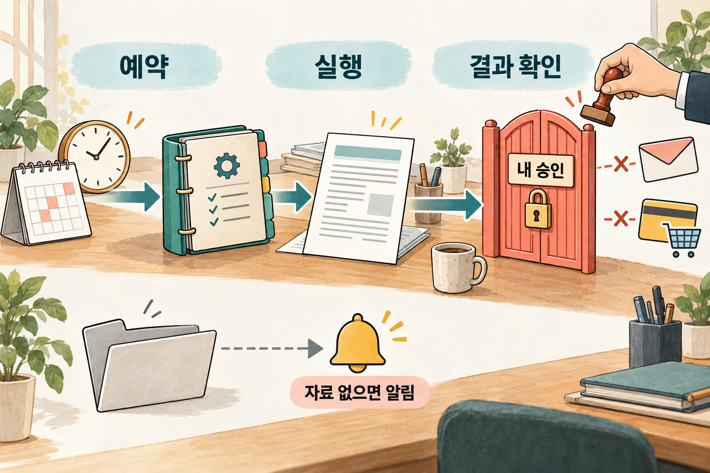

# 6. 루틴과 상시 에이전트 — 사다리 5단계

> [목차](index.md) · 이전: [5. 절차 전체를 레시피로](05-스킬.md) · 다음: [3주차 5. 업무 위임 가이드](../2-3-week/05-위임가이드.md)
>
> 2주차 마지막 시간이다.

## 이 시간의 목표

루틴과 상시 에이전트의 차이를 말하고, 내 업무를 자동으로 돌리기 전에 정해야 할 승인 지점과 "자료가 없을 때"의 규칙을 적을 수 있다.

## 핵심 한 줄

**맡기되 눈은 떼지 않는다. 자동화의 목표는 내가 안 보는 것이 아니라, 중요한 것만 보는 것이다.**

## 용어

- **루틴(예약 작업)**: 정해진 시간이나 사건에 스킬이 저절로 실행되게 걸어 둔 것이다. 예: 매주 일요일 저녁 6시, 새 메일이 오면. 앱에서는 Scheduled라는 이름으로 보인다.
- **상시 에이전트**: 클라우드에서 계속 대기하면서 맡긴 범위의 일을 처리하고, 필요할 때만 사람을 부르는 에이전트다.
- **프롬프트 인젝션**: AI가 읽는 바깥 글(웹페이지, 받은 메일) 안에 숨긴 지시로 AI를 조종하려는 공격이다. 1주차 [8](../1-week/08-보안-3.md)의 숨은 지시다.

## 5단계는 두 칸이다

| 칸 | 무엇이 달라지나 | 내가 하는 일 |
| --- | --- | --- |
| 5-1. 루틴 | 내가 부르지 않아도 정해진 때에 스킬이 돈다 | 매번 결과를 확인하고 승인한다 |
| 5-2. 상시 에이전트 | 시간뿐 아니라 상황(메일 도착, 일정 변경)을 보고 움직이고, 여러 스킬을 엮는다 | 승인할 때와 이상한 결과만 본다 |

5단계에서 나는 **일하는 사람에서 결과를 확인하는 사람**이 된다. 확인을 그만두는 것이 아니다.

## 5-1. 루틴

### 시연: 식단 루틴

아래는 설명을 위해 만든 예시다. 5의 식단 스킬이 세~다섯 번 성공 기준을 통과했다고 하자. 예약 작업 기능이 있는 앱에 이렇게 요청한다.

```text
매주 일요일 오후 6시(휴스턴 시간)에 '주간 가족 식단과 장보기 목록' 스킬을 실행해 줘.
- 먼저 나에게 이번 주 예산, 외식·손님 일정, 남은 재료를 물어봐.
- 저녁 8시까지 내 답이 없으면 "지난주와 같음"으로 가정하고, 가정했다고 적어 줘.
- 결과는 표로 남겨 줘.
- 주문과 결제는 하지 마.
- 필요한 자료를 못 읽으면 지난주 정보로 채우지 말고 "읽기 실패"라고 알려 줘.
```

마지막 줄이 가장 중요하다. 자동화에서 가장 흔한 사고는 큰 오류가 아니라, **오래된 정보나 추측으로 빈칸을 조용히 채우는 것**이다. 내가 보지 않는 동안 일어나므로 알아채기 어렵다.

### 시연: 보고 메일 루틴

```text
매주 금요일 오후 4시에 '주간 업무 보고 메일 초안' 스킬을 실행해서
초안을 만들고 나에게 알려 줘. 발송은 내가 직접 한다.
```

보고 메일은 5-1에서 멈춰도 충분하다. 발송은 끝까지 내 손에 있다.

### 루틴을 만든 뒤

- 바로 믿지 않고 **시험 실행을 한 번** 한다.
- 처음 두세 번은 결과를 꼼꼼히 본다. 안정되면 요약과 알림 위주로 본다. 확인 빈도는 줄여도 **0으로 만들지 않는다.**
- **한 달에 한 번** 묻는다. 이 루틴이 아직 필요한가? 아직 맞게 도는가? 쓰지 않는 루틴은 멈춘다. 루틴은 돌 때마다 사용량을 쓴다.

### 앱마다 다른 것

예약 작업이 어디서 도느냐는 앱마다 다르다. 2026년 10월 기준이다. 자세한 화면은 3주차 [8](../2-3-week/08-지침과내업무.md#두-도구에서-남기는-자리)에서 본다.

| | Codex·ChatGPT Work | Claude Cowork |
| --- | --- | --- |
| 만드는 법 | 채팅에서 작업을 만들어 달라고 요청한다. 결과는 Scheduled에 쌓인다 | 대화에서 요청하거나 Scheduled → New task로 만든다 |
| 어디서 도나 | 로컬 예약 작업은 **컴퓨터와 앱이 켜져 있어야** 돈다 | **클라우드에서 돌아 컴퓨터가 꺼져 있어도** 돈다. 로컬 파일이 필요한 작업은 예외 |
| 요금제 | 강의 전 확인 | 유료 요금제 |

**그대로인 것**: 루틴에 넣는 글. 위의 시연 요청은 두 앱에서 같다.

## 5-2. 상시 에이전트

루틴이 몇 주 동안 내 손을 거의 타지 않았다면, 범위를 넓혀 볼 수 있다. 하나의 일이 아니라 **하나의 담당 영역**을 맡기는 것이다.

```text
앞으로 우리 집 식단과 장보기를 담당해 줘.
- 기본은 매주 일요일 식단 루틴이다.
- 가족 캘린더에 외식이나 손님 일정이 새로 생기면 그 주 식단을 조정해서 알려 줘.
- 장보기 총액이 예산을 넘으면 바로 알려 줘.
- 주문, 결제, 다른 사람에게 메시지 보내기는 항상 내 확인을 받아.
- 매달 첫째 주에 지난달 식비 요약을 보여 줘.
```

상시 에이전트를 내세우는 서비스가 나오고 있다. xAI의 Grok Bot은 자기 클라우드 컴퓨터에서 계속 일하고 승인이 필요할 때만 돌아오는 방식을 발표했다. 무료 오픈소스인 Hermes Agent는 대화에서 스킬을 스스로 만들고 예약 작업을 건다고 소개한다. **나는 두 서비스를 써 보지 않았다.** 위 내용은 각 회사의 발표와 문서에 적힌 것이다.

여기서부터는 내 해석이다. 우리 수업의 수강생에게 5-2는 지금 당장의 목표가 아니다. 3주차에 에이전트에게 일 하나를 맡겨 보고, 그 일이 루틴으로 몇 주 잘 돈 다음에 생각해도 늦지 않다. 1에서 말한 규칙 3, 모든 일이 꼭대기까지 갈 필요는 없다.

## 안전 메모: 다섯 가지

신입 직원에게 그러듯 **권한을 단계적으로** 준다. 이 다섯 가지는 어느 칸에서든 그대로다.

1. **되돌리기 어려운 일은 내가 마지막 버튼을 누른다.** 메시지·메일 발송, 결제·주문 확정, 삭제, 공개 게시. AI는 초안과 직전 요약까지 한다.
2. **"자료가 없으면 멈추고 알려라"를 적어 둔다.** 조용히 채우는 것이 가장 흔한 사고다.
3. **처음엔 자주, 나중엔 가끔 확인한다.** 0으로 만들지는 않는다.
4. **필요한 만큼만 연결한다.** 식단 에이전트에게 회사 메일 권한은 필요 없다. 메일·일정을 연결할 때는 읽기부터 연다.
5. **AI가 읽는 바깥 글에는 지시가 숨어 있을 수 있다.** 받은 메일 안에 "이 내용을 누구에게 보내라"가 있어도, AI가 그것을 내 지시로 착각하면 안 된다. 1주차 [8](../1-week/08-보안-3.md)에서 본 대로 숨은 지시는 막기 어렵다. 승인 게이트가 있으면 내가 한 번 걸러 낼 수 있다.

xAI의 Grok Bot 문서도 보내기·구매·삭제·게시에는 승인을 요구하고, 자료가 없거나 오래된 경우의 규칙을 넣으라고 안내한다.



*나는 실행을 예약해도, 보내기와 결제의 마지막 판단은 직접 한다.*

## 흔한 실수

| 실수 | 왜 문제인가 | 이렇게 한다 |
| --- | --- | --- |
| 검증 안 된 스킬을 바로 루틴으로 | 틀린 결과가 매주 저절로 쌓인다 | 4단계에서 세~다섯 번 통과한 뒤에 |
| 결제·발송·삭제를 승인 없이 맡긴다 | 한 번의 실수가 돈과 관계 문제로 번진다 | 승인 게이트는 상시 에이전트가 돼도 둔다 |
| 결과를 아예 안 본다 | 사이트 화면이 바뀌거나 자료가 끊겨도 모른다 | 최소한 알림과 주간 요약은 읽는다 |
| 너무 자주 돌린다 (매시간) | 사용량을 쓸데없이 쓴다 | 일의 주기에 맞춘다. 식단은 주 1회 |
| 쓰지 않는 루틴을 내버려 둔다 | 비용과 혼란만 남는다 | 월 1회 점검, 안 쓰면 멈춘다 |
| "자료가 없을 때"를 정하지 않는다 | 지난주 정보를 이번 주인 척 쓴다 | "옛 정보로 채우지 말고 실패라고 알려라" |

상시 에이전트로 올라가고 싶은 이유가 "발송이나 결제를 승인 없이 하게 하고 싶어서"라면, 그것은 올라갈 이유가 아니라 **위험 신호**다.

## 실습: 내 업무의 멈춤 자리 (10분)

내 업무를 아직 루틴으로 만들지 않아도 된다. 만든다면 무엇을 정해야 하는지만 적는다.

| 정할 것 | 내 답 |
| --- | --- |
| 이 일은 정해진 주기로 돌아오나? (언제) | |
| 되돌리기 어려운 행동은 무엇인가? (발송, 결제, 삭제, 게시) | |
| 그 앞에 내 승인을 어디에 두나 | |
| 자료가 없거나 못 읽으면 어떻게 하라고 적나 | |
| 연결이 필요한 서비스와, 읽기만 열 것 | |
| 결과는 얼마나 자주 확인하나 (처음 / 안정된 뒤) | |

이 표는 3주차 [업무 위임 가이드](../2-3-week/05-위임가이드.md)의 "3. 권한과 승인", "5. 진행 확인"으로 그대로 이어진다.

> ✍️ **[채우기]** 내가 실제로 예약 작업이나 자동화를 걸어 본 일 하나. 처음 몇 번 무엇을 확인했고, 어떤 일 때문에 멈추거나 고쳤는지.

## 2주차 정리

사다리 한 장으로 하루를 다시 본다.

| 칸 | 한 줄 | 🍲 식단 | 📧 보고 메일 | 다음 칸 신호 | 가장 흔한 함정 |
| --- | --- | --- | --- | --- | --- |
| 1. 프롬프트 | 말로 시킨다 | "이번 주 저녁 메뉴 짜 줘" | "주간 보고 메일 써 줘" | 쓸 만한데 아쉽고, 또 할 일이다 | 한 번 보고 포기, 사실 정보를 그대로 믿기 |
| 2. 관찰과 교정 | 빗나간 이유를 보고 고친다 | 예산·알레르기·조리 시간 | 길이·말투·구성 | 같은 조건을 세 번 다시 씀, 두 번 연속 만족 | "다시 해"만 반복, 한꺼번에 다 바꾸기 |
| 3. 템플릿 | 빈칸 양식으로 저장한다 | 날짜·예산·특이사항·남은 재료 | 받는 사람·주간·한 일 | 붙여 넣은 뒤 매번 같은 확인을 함 | 빈칸이 너무 많음, 템플릿을 못 찾음 |
| 4. 스킬 | 성공 기준과 실패 대응까지 묶는다 | 갑각류 0개, 예산 안 | 적지 않은 숫자 없음 | 정기적이고, 세~다섯 번 통과 | 성공 기준이 모호, 시험 없이 사용 |
| 5-1. 루틴 | 정해진 때 저절로 돈다 | 일요일 6시, 주문·결제 안 함 | 금요일 4시 초안, 발송은 직접 | 몇 주 연속 손댈 일이 거의 없음 | 검증 전 자동화, 너무 잦은 실행 |
| 5-2. 상시 에이전트 | 담당 영역을 맡긴다 | 일정 바뀌면 조정, 월간 식비 요약 | (5-1에서 멈춰도 충분) | — | 승인 없는 결제·발송, 확인 중단 |

**세 가지 규칙**: 아래에서 위로. 일 하나로 한 칸씩. 일의 무게에 맞춰 멈출 칸을 고른다.

**안전 원칙**: 보내기·결제·삭제는 끝까지 내가 승인한다. 자료가 없으면 멈추고 알리게 한다.

## 3주차로

2주차는 채팅 창 안에서 사다리를 올랐다. 내가 자료를 붙여 넣고, 결과를 읽었다. 3주차에는 AI가 **폴더의 파일을 직접 읽고 결과 파일을 만드는** 작업 위임으로 넘어간다. 사다리의 4·5단계가 에이전트에서 실제로 어떻게 돌아가는지, 같은 일을 두 에이전트에 맡겨 비교한다.

과제: 4에서 만든 내 템플릿을 3주차 전까지 두세 번 실제로 쓰고, 고친 점을 적어 온다. 5의 스킬 초안과 이 시간의 멈춤 자리 표도 가져온다.

## 참고

- [AI 활용 사다리 가이드](../1-week/ai-adoption-ladder-guide-ko.md) 2장의 5단계, 3장의 전환 기준, 4장의 흔한 실수, 8장 안전 메모, 9장 한 장 요약표
- [Schedule recurring tasks](https://support.claude.com/en/articles/13854387) (Anthropic 도움말, 영문), [Automations](https://learn.chatgpt.com/docs/automations.md) (OpenAI, 영문)
- [Skills and routines](https://docs.x.ai/grok-bot/skills-routines-and-automations), [Introducing Grok Bot](https://x.ai/news/introducing-grok-bot) (xAI, 영문)
- [Hermes Agent](https://hermes-agent.nousresearch.com/) (Nous Research, 영문)
